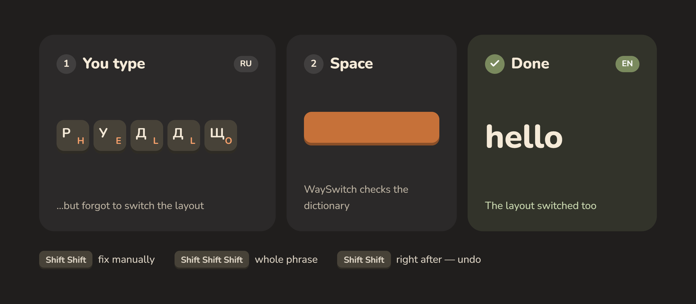
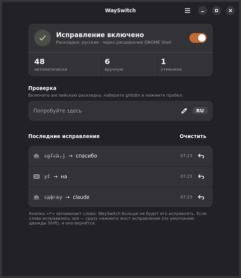
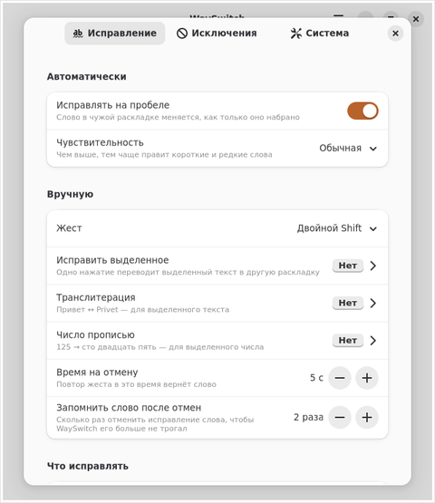

<p align="center">
  
</p>

<p align="center">
  <a href="https://github.com/Wetoshkin/WaySwitch/releases"></a>
  <a href="https://github.com/Wetoshkin/WaySwitch/actions/workflows/ci.yml"></a>
  
  
  
  <a href="LICENSE"></a>
</p>

<p align="center">
  <a href="README.md">Русский</a> · <b>English</b>
</p>

**A modern Punto Switcher and Caramba Switcher alternative for Linux on Wayland.**

WaySwitch fixes a word typed in the wrong layout (`ghbdtn` instead of
«привет») right away, on Space — no hotkeys, no manual layout switching. It
works on Wayland in GNOME, KDE Plasma, Sway, Hyprland, Xfce, MATE,
Budgie, LXQt and (experimentally) Cinnamon, where classic tools of this kind can neither listen to the
keyboard nor type for you. The interface is in Russian: WaySwitch currently
supports the Russian ↔ English pair.

<p align="center">
  
</p>

## Features

- **Fix on Space.** `ghbdtn ` becomes `привет `, and the layout switches too.
  Numbers, paths, URLs, camelCase and abbreviations are left alone.
- **URLs right away.** A URL scheme typed in the wrong layout is fixed
  without waiting for Space.
- **Manual fix.** Double Shift fixes the last word, triple Shift the whole
  phrase. You can pick a single key instead (Right Ctrl, ScrollLock, an F-key).
- **Fix selection.** Select a phrase typed in the wrong layout, press your
  key — done.
- **Undo that learns.** The same gesture right after an automatic fix
  restores the word and never touches it again.
- **Small typos** (each can be turned off in Preferences): two capitals at
  the start of a word (`ПРивет` → «Привет», Shift released too late); a
  comma or period typed as the last Russian letter on the same key
  (`пирогб` → «пирог,»); particles typed together (`чтото` → «что-то», `кембы` → «кем бы»);
  a missing space before a capitalised word (`сонатуБаха` → «сонату Баха»).
- **Exceptions.** Words and programs to leave alone. Password fields are skipped.

<p align="center">
  
  &nbsp;
  
</p>

## Install

**You need** a Wayland session (not X11) and two layouts — Russian and a
Latin one. Ubuntu, Debian, Fedora, openSUSE, Arch, CachyOS, EndeavourOS,
Manjaro and most other modern distributions are fine.

1. Open a terminal (in KDE it is **Konsole**).
2. Paste the command with <kbd>Ctrl</kbd>+<kbd>Shift</kbd>+<kbd>V</kbd> and press <kbd>Enter</kbd>:

   ```bash
   curl -fsSL https://raw.githubusercontent.com/Wetoshkin/WaySwitch/main/packaging/get.sh | sh
   ```

3. The script detects your distribution, says what it is going to do and
   asks for confirmation, then for your password (it is not shown while you
   type — that's normal).
4. **Log out and back in.** WaySwitch starts by itself; the first time you
   open its window it checks the system and tells you if anything is missing.

| Distribution | What happens |
|---|---|
| Ubuntu 24.04+, Debian 13 and derivatives | downloads the `.deb` from the latest release, installs with `apt` |
| Fedora 41+ | installs the `.rpm` with `dnf` |
| Silverblue, Kinoite, Bazzite | layers the `.rpm` with `rpm-ostree` (reboot afterwards) |
| openSUSE Tumbleweed, Slowroll | installs the `.rpm` with `zypper` |
| Arch, CachyOS, EndeavourOS, Manjaro | AUR package via `paru`/`yay` once it is published, otherwise from source |
| others | from source via `packaging/install.sh` |

Uninstall: the same command with `| sh -s -- --uninstall`.

## Gestures

| Gesture | Action |
|---|---|
| <kbd>Shift</kbd> <kbd>Shift</kbd> | fix the last word; with nothing typed — just switch the layout |
| <kbd>Shift</kbd> <kbd>Shift</kbd> <kbd>Shift</kbd> | fix the whole phrase |
| <kbd>Shift</kbd> <kbd>Shift</kbd> right after an automatic fix | undo and remember the word |
| your key (Preferences → Manual) | fix the selected text |

## Settings

Everything is set with the mouse and applied immediately. Open **WaySwitch**
from the app menu; preferences are under <kbd>☰</kbd> or
<kbd>Ctrl</kbd>+<kbd>,</kbd>. On **Sway and Hyprland** the indicator is a
Waybar module (`wayswitch waybar`), pausing is bound to a hotkey (`wayswitch toggle`; the last word is
fixed with the Shift gesture), and ready-made config snippets are
copied from Preferences → System → Panel. Sway and plain Hyprland do not
start systemd user services: add `exec wayswitch run` (Sway) or
`exec-once = wayswitch run` (Hyprland) to the config. On **Xfce, MATE, Budgie, LXQt**
(labwc / Wayfire) WaySwitch reads the layouts from the compositor's XKB
settings — see the Russian README for snippets.

## Updating

Once a day WaySwitch asks GitHub whether a new version is out; if so, the
window shows a bar, the panel menu shows the version, and a notification is
sent once (can be turned off). You can also **Watch → Custom → Releases**.
To update, run the install command again — settings are kept. Log out and
back in afterwards.

## Troubleshooting

| Command | What it shows |
|---|---|
| `wayswitch doctor` | what works, what is missing and how to fix it |
| `journalctl --user -u wayswitch -n 50` | the latest log lines |
| `wayswitch dry-run` | detector decisions without touching the screen |

A word was fixed by mistake — press <kbd>Shift</kbd> <kbd>Shift</kbd> right
away. Still stuck — [open an issue](https://github.com/Wetoshkin/WaySwitch/issues/new)
with the output of these commands (the window has it under About →
Troubleshooting).

## FAQ

**Is it safe?** WaySwitch reads key presses — otherwise it could not fix
words. Typed text is never written anywhere or sent anywhere; corrected words
do not even reach the log. The only network request is an anonymous “what is
the latest version” (can be turned off). The code is open.

**X11?** No, WaySwitch is built for Wayland.

**Flatpak or Snap?** No: the program needs direct access to `/dev/input`,
which a sandbox does not give.

## Status

Alpha. Tested on CachyOS with GNOME 51. KDE Plasma 6, Sway, Hyprland and the
labwc/Wayfire desktops are covered by tests but not yet tried live — reports
are welcome.

## Development

```bash
pip install pytest ruff
python -m pytest -q
python -m ruff check .
```

Packages: `bash tools/build_deb.sh`, `bash tools/build_rpm.sh`,
`cd packaging/arch && makepkg -si`. Module map: [CLAUDE.md](CLAUDE.md).

## License

Code — MIT. Dictionaries in `wayswitch/data` are built from
[FrequencyWords](https://github.com/hermitdave/FrequencyWords), CC-BY-SA 4.0.
