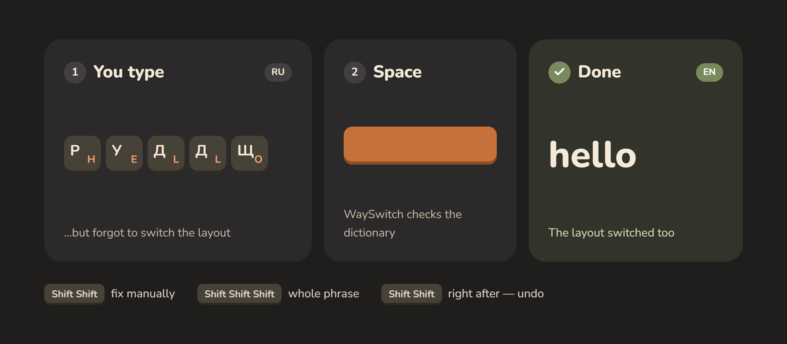
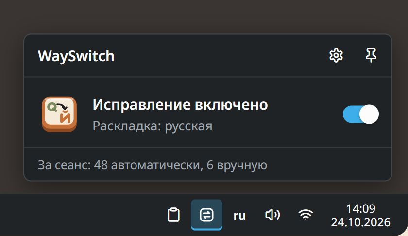
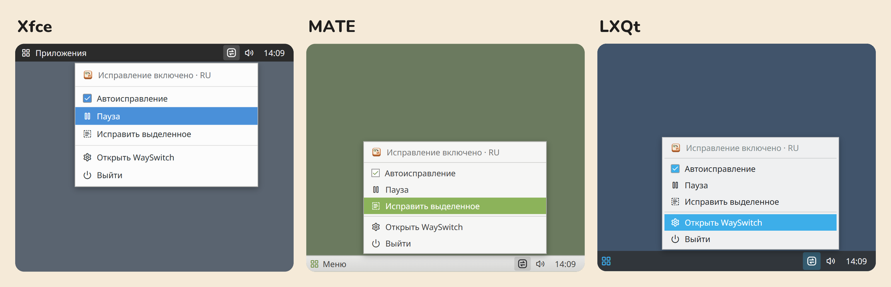
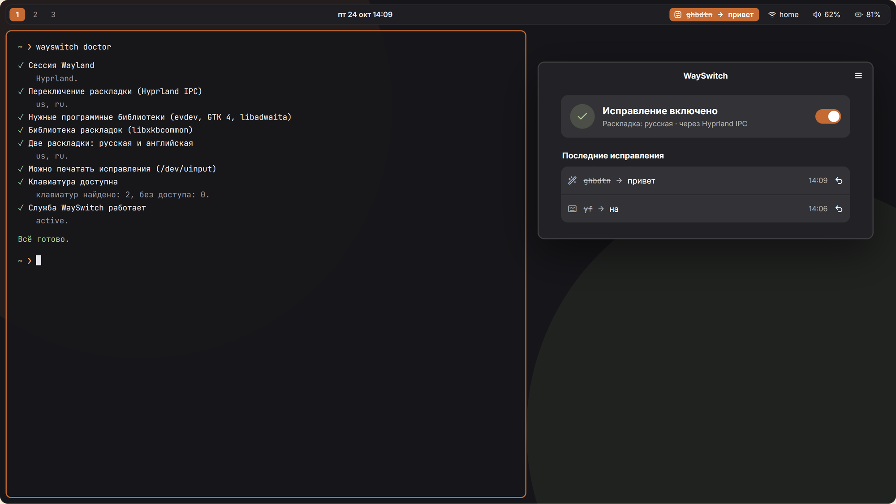
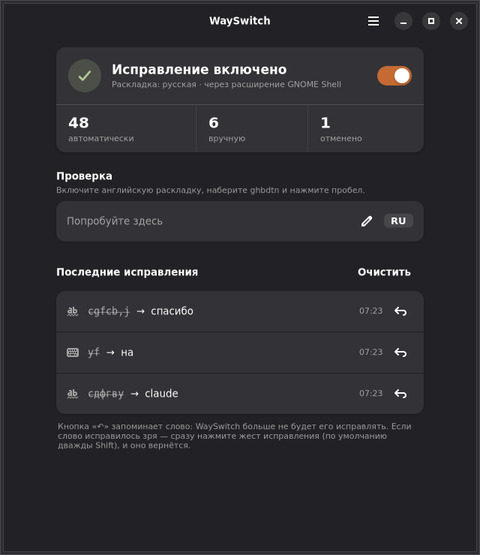
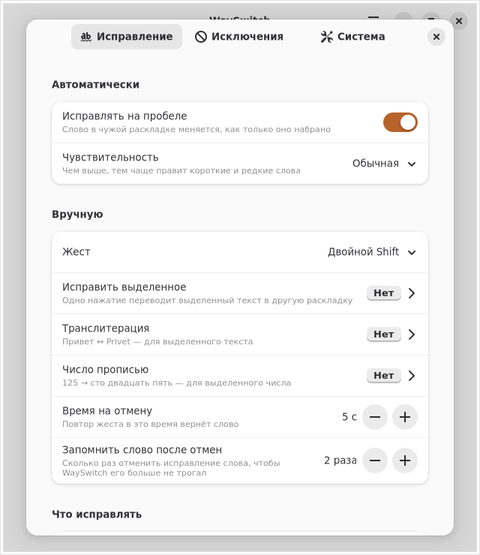

<p align="center">
  
</p>

<p align="center">
  
  
  
  
  
  
  
  <br>
  
  
  
  
  <a href="#status"></a>
  <a href="#status"></a>
  
  <a href="LICENSE"></a>
</p>

<p align="center">
  <a href="README.md">Русский</a> · <b>English</b>
</p>

**Automatic Russian–English keyboard layout correction for Linux on Wayland.**

Packages and checksums: [latest published release](https://github.com/Wetoshkin/WaySwitch/releases/latest).
See [project status](docs/PROGRESS.md) for completed changes, verification and remaining work.

WaySwitch fixes a word typed in the wrong layout (`ghbdtn` instead of
«привет») right away, on Space — no hotkeys, no manual layout switching. It
works on Wayland in GNOME, COSMIC, KDE Plasma, Sway and Hyprland. Xfce, MATE,
Budgie and LXQt require a Wayland session on labwc or Wayfire. See the
[compatibility table](#status) for conditions and Umbriel/NixOS validation.
**X11 and Cinnamon (including the default Linux Mint session) are unsupported.**
The interface is available in Russian and English, selected from the system
locale; correction supports the Russian ↔ English pair.

<p align="center">
  
</p>

## Features

- **Fix on Space.** `ghbdtn ` becomes `привет `, and the layout switches too.
  Numbers, paths, URLs, camelCase and abbreviations are left alone.
- **Russian е/ё and English contractions.** Dictionary lookup treats «е» and
  «ё» as one key while the corrected text keeps the letter you typed
  (`небоскреб` ↔ `небоскрёб`). Common contractions (`I'm`, `I'd`, `won't`,
  `don't`, `can't`) are recognised across layouts; the shortest forms follow
  the normal short-word sensitivity rules.
- **Manual fix.** Double Shift fixes the last word, triple Shift the whole
  phrase. You can pick a single key instead (Right Ctrl, ScrollLock, an F-key).
- **Fix selection.** Select a phrase typed in the wrong layout, press your
  key — done. Requires accessible AT-SPI fields; tested in GNOME and KDE.
- **By the start of a word.** If the first four letters clearly belong to
  the other layout (`ghbd` starts no English word but does start «прив…»),
  the prefix can be corrected before Space using native range replacement
  in Writer/Calc. Keyboard retyping waits for Space so continued typing
  cannot mix with a prefix replacement. The same restriction applies to URLs.
- **Transliteration and numbers in words** for the selected text, on keys of
  your choice, in supported AT-SPI fields.
- **Undo that learns.** The same gesture right after an automatic fix
  restores the word; after two undos it is added to exceptions. The threshold
  is configurable.
- **Personal dictionary.** Add, edit or exclude a correct word and its language
  in Preferences; for example, `гигтег` → `ubuntu`. Learning from manual
  corrections is separately opt-in and off by default.
  [How to use it](docs/personal-dictionary.md#english).
- **Small typos** (each can be turned off in Preferences): an accidental
  Caps Lock (`пРИВЕТ` → «Привет», Caps Lock is turned off); two capitals at
  the start of a word (`ПРивет` → «Привет», Shift released too late); a
  comma or period typed as the last Russian letter on the same key
  (`пирогб` → «пирог,»); particles typed together (`чтото` → «что-то», `кембы` → «кем бы»);
  a missing space before a capitalised word (`сонатуБаха` → «сонату Баха»).
- **Exceptions.** Words and programs to leave alone. Recognised password fields
  are skipped when password protection is enabled; it is off for new installations.

The following desktop integrations are illustrated with mockups. Full testing
with a physical keyboard is still needed; see [Status](#status).

<p align="center">
  
  <br>
  
  <br>
  
</p>

<p align="center">
  
  &nbsp;
  
</p>

## Install

**You need** a Wayland session (not X11). Corrections require Russian and
English layouts. Other input sources can remain installed: WaySwitch leaves
them alone and resumes when you return to ru/en. Without a ru/en pair the
application starts with a warning. Supported installation targets include Ubuntu 24.04+, Debian 13+,
Fedora 41+, openSUSE Tumbleweed, Arch and their compatible derivatives.
The installer checks the system before making changes.

**NixOS:** use the separate [package and system module guide](docs/nixos.md).
The command below is for other distributions.

1. Open a terminal (in KDE it is **Konsole**).
2. Paste the command with <kbd>Ctrl</kbd>+<kbd>Shift</kbd>+<kbd>V</kbd> and press <kbd>Enter</kbd>:

   ```bash
   curl -fsSL https://raw.githubusercontent.com/Wetoshkin/WaySwitch/main/packaging/get.sh | sh
   ```

3. The script detects your distribution, says what it is going to do and
   asks for confirmation, then for your password (it is not shown while you
   type — that's normal).
4. **Restart the computer** (save your documents first). WaySwitch then
   starts by itself (on Sway and Hyprland — once `exec wayswitch run` is in
   the config, see below); the first time you open its window it checks the
   system and tells you if anything is missing.

| Distribution | What happens |
|---|---|
| Ubuntu 24.04+, Debian 13 and derivatives | downloads the `.deb` from the latest release, installs with `apt` |
| Fedora 41+ | installs the `.rpm` with `dnf` |
| Silverblue, Kinoite, Bazzite | layers the `.rpm` with `rpm-ostree` (reboot afterwards) |
| openSUSE Tumbleweed, Slowroll | installs the `.rpm` with `zypper` |
| Arch, CachyOS, EndeavourOS, Manjaro | AUR package via `paru`/`yay` once it is published, otherwise from source |
| NixOS | use the [package and system module](docs/nixos.md), without the generic installer |
| others | from source via `packaging/install.sh` |

For script installations, uninstall with the same command and `| sh -s -- --uninstall`.

Before installing a `.deb` or `.rpm`, the script verifies its SHA256 and size
against the selected GitHub release metadata. Missing checksums or failed
verification stop installation. This check requires `python3`; the installer
reports the prerequisite if it is missing.

If the selected release has no package, source installation uses that release
tag instead of `main`: the tag is resolved to an immutable commit and the
downloaded source is checked against it before installation. Changes to `main`
have no effect. Selecting the release and checking the tag require `curl` and
`python3`; the installer reports missing prerequisites. `WAYSWITCH_SRC` still
installs and uninstalls the explicitly named local checkout without consulting
a release.

### Flatpak and AppImage

The AppImage setup assistant shows the distribution, native package
manager and version compatibility. After confirmation it hands first installation
to the system package manager in a terminal; mismatched versions receive
instructions. Arch and AUR require manual review. Starting a terminal does not
confirm installation or service activation. See [native-service handoff](docs/appimage-companion.md).

Portable settings clients are available; correction requires a separate native
WaySwitch service on the host. Update an existing service through its original
source: a new AppImage or Flatpak does not update it. Use the service
and GUI from the same [release](https://github.com/Wetoshkin/WaySwitch/releases).
The first-run window explains companion
installation, startup and diagnostics. Settings and pause state are shared.

Download the local bundle and `SHA256SUMS` from the same release:

```bash
grep -E '^[[:xdigit:]]{64}  WaySwitch-Settings\.flatpak$' SHA256SUMS | sha256sum -c - && \
flatpak install --user --or-update ./WaySwitch-Settings.flatpak
flatpak run io.github.Wetoshkin.WaySwitch.Gui
```

The bundle offers the official repository for GNOME Runtime 50. To update a local
bundle, download the replacement, verify it against the release's `SHA256SUMS`,
then run `flatpak install --user --or-update ./WaySwitch-Settings.flatpak`.
Remove the GUI with `flatpak uninstall --user io.github.Wetoshkin.WaySwitch.Gui`.
The application has not been published on Flathub. `flatpak update` works for
a configured application repository, rather than a standalone bundle file.

AppImage requires x86_64 Linux with glibc 2.39+ (Ubuntu 24.04+, Debian 13+):

```bash
grep -E '^[[:xdigit:]]{64}  WaySwitch-Settings-x86_64\.AppImage$' SHA256SUMS | sha256sum -c - && \
chmod +x WaySwitch-Settings-x86_64.AppImage && \
./WaySwitch-Settings-x86_64.AppImage --appimage-extract-and-run
```

Python, GTK4 and libadwaita are bundled. Close the GUI and replace the file after
verifying its release checksum to update; delete the file to remove it. AppImage
runs with the user's permissions. Flatpak has no input-device access. Removing
either portable GUI leaves the native service and shared settings in place.

### COSMIC

Configure Russian and English layouts in COSMIC Settings. The backend reads the
actual keyboard map and group from the compositor and waits for switch
acknowledgements. Tested on COSMIC 1.11 with multiple keyboards in one seat;
multiple keyboard seats are unsupported.

After every service start/restart and screen lock, unlock the desktop and
explicitly enable correction using the GUI/tray or `wayswitch resume`.
COSMIC does not provide a reliable public unlocked-state acknowledgement, so
correction never resumes automatically. Unknown protection state keeps it off;
`wayswitch doctor` explains recovery. Automatic Caps Lock deactivation is disabled
because the compositor's compiled keymap does not expose original XKB options.

### NixOS and Umbriel

A package and system module are provided for NixOS; see the
[setup guide](docs/nixos.md) for dependencies, device access and service startup.
Umbriel uses native IPC and requires the same layout list and order on ordinary
keyboards and `uinput`, plus a graphical session registered with logind.
Unknown session state blocks both automatic and manual correction.
Automatic Caps Lock deactivation is unavailable without XKB option information.

With several ru/en variants, WaySwitch uses the current variant and the first
opposite language in system order. GNOME needs the WaySwitch extension for
additional input sources; the fallback system shortcut cannot reliably track
three or more. labwc/Wayfire retain their counter limitation: mouse switches
are invisible, and automatic correction requires explicit `backend.track_hotkey`.
Additional layouts need ordinary cyclic XKB shortcuts such as
`grp:alt_shift_toggle`; ambiguous bidirectional shortcuts leave the service passive.

### Remote desktop (RDP)

WaySwitch reads keyboard devices belonging to the local session. Separate RDP
sessions are unsupported: their input may bypass these devices, and `uaccess`
grants device access to the active local session. If `/dev/uinput` is unavailable,
the service waits for access and continues startup automatically when it returns.
Use `wayswitch doctor` and `journalctl --user -u wayswitch -n 30` to diagnose it.
Missing udev rules or the `uinput` kernel module must be fixed before startup
can continue.

## Gestures

| Gesture | Action |
|---|---|
| <kbd>Shift</kbd> <kbd>Shift</kbd> | fix the last word; with nothing typed — just switch the layout |
| <kbd>Shift</kbd> <kbd>Shift</kbd> <kbd>Shift</kbd> | fix the whole phrase |
| <kbd>Shift</kbd> <kbd>Shift</kbd> right after an automatic fix | undo; after two undos, add the word to exceptions by default |
| your key (Preferences → Manual) | fix selection, transliterate or spell out a number (GNOME) |

Press Shift twice within 0.4 seconds. Gestures are disabled while WaySwitch
is paused or the screen is locked.

## Settings

Everything is set with the mouse and applied immediately; the typing delay
takes effect after the service restarts (see below). Open **WaySwitch**
from the app menu; preferences are under <kbd>☰</kbd> or
<kbd>Ctrl</kbd>+<kbd>,</kbd>. On **Sway and Hyprland** the indicator is a
Waybar module (`wayswitch waybar`), pausing is bound to a hotkey (`wayswitch toggle`; the last word is
fixed with the Shift gesture), and ready-made config snippets are
copied from Preferences → System → Panel. Sway and plain Hyprland do not
start systemd user services: without uwsm, add `exec wayswitch run` (Sway) or
`exec-once = wayswitch run` (Hyprland) to the config. On **Xfce, MATE, Budgie, LXQt**
(labwc / Wayfire) WaySwitch reads the layouts from the compositor's XKB
settings — see the Russian README for snippets.

**Closing the window.** A native launch stays in the icon like `--tray`:
the service keeps correcting, and launching WaySwitch again from the app menu
reopens the same window with its history. In GNOME the icon requires the
AppIndicator extension to be enabled (it is usually already enabled on
Ubuntu). The portable Flatpak and AppImage GUIs keep an independent window
lifecycle: an ordinary close ends the GUI together with its icon while the
native service keeps running; `--tray` keeps the icon.

**Interface language.** The window, notifications, panel icon, Waybar module
and human-readable CLI, doctor and explain output
choose the language at startup from `LANGUAGE`, `LC_ALL`, `LC_MESSAGES` and
`LANG`. A Russian locale gives the Russian interface; English, `C`, `C.UTF-8`,
`POSIX`, an unknown or an unset locale give English (the source language).
For `C`/`POSIX`, `LANGUAGE` does not enable the Russian catalog. The Plasma
widget uses KDE's system language. JSON,
reason values, the version line and exit codes retain their previous contract.

The `[meta]` section with `schema = 3` identifies the `config.toml` format. Files without the marker are treated as legacy: their
`settle_ms = 30` is migrated to 120. An explicit 30 saved by this version stays
30. An older WaySwitch version ignores the marker and replaces 30 with 120 again
when it saves the file. Saving over a file with an unsupported format marker
is rejected. The typing delay is read when the service starts: restart the
service after changing it (`systemctl --user restart wayswitch` for a system
install); other settings reload immediately.

## Updating

Use **Preferences → System → Updates…** or `wayswitch update`;
`wayswitch update --install` installs an available update.
WaySwitch keeps the installation source: AUR and distribution packages use
their manager; GitHub installations use release packages. Confirmation and
administrator authentication stay with the package manager.

If the installed version has no `update` command, update the native service
using its original method. AppImage and Flatpak update their window separately
from the service. After a manual installation, reopen the window. GNOME extension
updates may require signing in again; atomic systems may need a reboot.
Settings and exceptions are preserved. See the [update guide](docs/updates.md).

## Troubleshooting

| Command | What it shows |
|---|---|
| `wayswitch doctor` | what works, what is missing and how to fix it |
| `wayswitch explain ghbdtn` | why the detector fixed or kept a word; `--from ru` reverses the direction |
| `journalctl --user -u wayswitch -n 50` | the latest log lines |
| `wayswitch dry-run` | detector decisions without touching the screen |

`wayswitch explain <word>` evaluates only `Detector.decide` for the word you
pass: the explicit us/ru layouts and an empty context. It reads `sensitivity`,
and `two_capitals_fix` from `config.toml`, exceptions from `exceptions.txt`,
and words from `learned_words.txt`.
It writes nothing and
does not contact the service, read focus, send keys, or change the layout.
Options: `--from en|ru` (default `en` = us),
`--sensitivity conservative|normal|aggressive`, `--json`. It does not evaluate
punct/split/particles/caps, the early trigger or triple Shift; layout variants,
AltGr, dead keys and XKB options are not considered. Requires Linux with
libxkbcommon.

Passing the mandatory checks does not confirm that the focused field is accessible.
If the active application is unknown, run `sleep 5; wayswitch doctor` and focus a
normal text field in the target application during that delay. Protected automatic
correction waits for verified focus; the manual gesture remains available.

### Reporting a missed correction

1. Open the application where the correction was missed and find the text field
   where it happened.
2. In a terminal in the same graphical session, run `wayswitch doctor --delay 5`
   using the WaySwitch installation on the host.
   Within five seconds, switch back to the application, click the ordinary text
   field and leave it focused until the check finishes. You do not need to type.
3. Return to the terminal and paste the whole report into the issue. Include the
   application name, a sample word and what happened after you pressed Space.
   Review the output for personal paths before posting.

The active application line describes the field detected during the check. The
last section shows the running daemon's auto-correction setting, any pause or
other restriction, the backend and the layout. It also says if the daemon cannot
be reached. The report omits the field contents and window title.

If your installed version reports that `--delay` is unknown, run
`sleep 5; wayswitch doctor; wayswitch status --json` and switch back to the
field within five seconds. Older versions print daemon status separately.

A word was fixed by mistake — press <kbd>Shift</kbd> <kbd>Shift</kbd> right
away. Still stuck — [open an issue](https://github.com/Wetoshkin/WaySwitch/issues/new)
with diagnostic output (also available under About → Troubleshooting).
Remove private information before posting, including device names, paths
and session details. Typed words are not logged, including in `--verbose`
and `dry-run` modes. See [Contributing](CONTRIBUTING.md).

## FAQ

**What happens to my data?** Correction runs locally; typed text is not sent
over the network. Recent corrections are held in memory. Word exceptions,
including those learned from undoing corrections, are saved to
`~/.config/wayswitch/exceptions.txt`. Explicit personal words and words learned
with opt-in positive learning are saved to `~/.config/wayswitch/learned_words.txt`
and its previous backup. Logs, including `--verbose` and
`dry-run`, record decisions and operation results without typed words.
When focus is unknown or stale, correction text is withheld from the
window history over D-Bus and from learning after undo.

GitHub update checks send the IP address and WaySwitch version in the
`User-Agent`, but no typed text. AUR installations
check AUR RPC with the package name; distribution packages use their own
package manager without contacting GitHub. Checks can be disabled in Preferences.

Password protection is off by default for new installations; saved preferences
are preserved on update. Detection depends on the application exposing that information.
Pause WaySwitch before entering sensitive text in a field whose protection
you have not verified. The udev rule grants keyboard access to other processes
running as the active user as well.

With password protection enabled, automatic correction is disabled in terminals.
Terminals do not reliably distinguish hidden passwords from ordinary input.
Manual gestures remain available. Terminal input is withheld from correction
history and learning.

**X11?** No, WaySwitch is built for Wayland.

**No tray icon in GNOME?** Enable AppIndicator in the Extensions app. On
regular Fedora, install it with `sudo dnf install gnome-shell-extension-appindicator`
if missing. Bazzite already bundles the extension.

**Flatpak and AppImage.** These contain the settings GUI with an explicit native
host companion, as described above. The daemon needs `/dev/input`, `/dev/uinput`,
a udev rule and desktop integration. A Snap package is not available.

## Status

Desktop support does not guarantee compatibility with every application:
with password protection enabled, automatic correction requires verified AT-SPI
focus. With protection off and no exclusions, ordinary keyboard replacement does
not require it. Selection and native range replacement still depend on AT-SPI.

| Environment | Integration and conditions | Validation |
|---|---|---|
| GNOME 46–51 | WaySwitch extension; IBus fallback | Live GNOME 50.1/51 sessions on Ubuntu, CachyOS and Bazzite |
| KDE Plasma 6 | KWin D-Bus layouts; widget or tray icon | Plasma 6.6.6 Wayland VM: Kate/KWrite, Qt/GTK fields and Konsole |
| COSMIC | Compositor keymap and layout; explicitly enable correction after startup and unlocking | Live COSMIC 1.11 session |
| Sway, Hyprland | Compositor IPC; Waybar indicator | Automated tests; physical keyboard checks still needed |
| labwc, Wayfire | XKB configuration and shortcut counter; opt-in automatic mode | Automated tests; live checks still needed |
| Xfce, MATE, Budgie, LXQt | Wayland sessions on labwc/Wayfire only; tray icon | Same limitations as the compositor |
| Umbriel | Native IPC, keymap and session protection | Live Ubuntu Wayland session: input, undo, password field, locking and VT changes |

**NixOS.** The [package and system module](docs/nixos.md) are included.
The Linux build and dependency checks passed; a live NixOS graphical session
has not been tested. A ru/en pair is required; additional layouts are allowed
and text is left alone while they are selected.

X11, Cinnamon and separate RDP sessions are unsupported.

Application checks below refer to GNOME unless stated otherwise.
KDE checks cover Writer with KF6 and GTK3, and selection in Kate/KWrite
and Writer. Calc was tested with GTK3 VCL; testing with KF6 was limited by
a LibreOffice plugin failure.

See [project status](docs/PROGRESS.md) for the live-test matrix and its limits.

Chrome checks cover ordinary fields, editable page elements, passwords and readonly fields.
The original eXpress message editor was tested in an isolated environment
without sending messages; an authenticated chat has not been tested.

Firefox Flatpak checks on Bazzite cover input, textarea, contenteditable and the
address bar. Native Telegram 7.4.1 on GNOME 51.1
passed both directions in an authenticated message composer, without sending
messages. This does not verify the Telegram Flatpak composer. ONLYOFFICE Desktop Editors 10.0.0
(Flatpak on Bazzite) did not expose an AT-SPI field tree on the tested setup;
automatic correction was not confirmed. In a separate control using the official
DEB on Ubuntu, the AT-SPI connection worked, but the document and Find controls
did not expose editable fields even with screen-reader support enabled.

GridCraft 0.13.0 Flatpak needs access to the accessibility bus:
`flatpak override --user --talk-name=org.a11y.Bus ai.storyteller.gridcraft`.
Save your workbooks and fully restart GridCraft after this change.
With this permission, an isolated instance passed automatic correction in
both directions. The native WaySwitch service is also required.

When retyping uses virtual key presses, observed physical input stops further
changes and can leave a partial correction. A physical key can still arrive
between a check and the next virtual key.

Password protection is off by default for new installations. Enabling it
may block auto-correction in MAX and other apps whose input fields cannot
be verified, and disables auto-correction in all terminals. The manual
gesture remains available. Explicitly saved `skip_password_fields` values
are preserved on update. With protection off and no application exclusions,
ordinary correction after Space does not wait for AT-SPI; input with unknown or protected focus is
still excluded from correction history and learning.

With password-field protection enabled, automatic correction waits for
verified AT-SPI focus. Use a manual gesture if the application's accessibility
bridge is unavailable. `wayswitch doctor` shows application identifiers for
exclusions. In GNOME, update the extension too and sign in again.
Buffered text, context and undo belong to the field where input was captured.
A confirmed field change discards the old span. With protection enabled,
a field that becomes verified partway through a word still requires a verified
native replacement before the prefix can be corrected.
COSMIC correction and lock-screen handling have been tested live. Explicit
confirmation is required after service startup and unlocking, as described above.

Selection correction, transliteration and numbers in words require usable
AT-SPI fields; checks cover GNOME and KDE. On labwc/Wayfire, automatic correction
requires explicit `backend.track_hotkey`; mouse layout switches are invisible
to the shortcut counter. LibreOffice and some Flatpak applications still have
known limitations: [LibreOffice and selection](https://github.com/Wetoshkin/WaySwitch/issues/18),
[Firefox, Telegram and ONLYOFFICE on Bazzite](https://github.com/Wetoshkin/WaySwitch/issues/19).

## Prepared selection actions (not released)

`wayswitch change-case` cycles a confirmed selection through lower case, upper
case and word capitals. It uses default Unicode casing, preserves combining
marks and treats an apostrophe between letters as part of the word. Case changes
can change length (`ß` → `SS`) and are not reversible after three steps.
The command preserves the active layout. Both source and result must be
representable in that layout, including GNOME text transport; otherwise the
command refuses before writing. Select the appropriate layout first.

`wayswitch mixed-layout --to ru` (or `--to en`) requires an explicit target.
For example, RU converts `привет vbh` to `привет мир`. Existing target-language
words and separators remain; converted words must exist in the target model.
Mixed tokens, technical text, unknown words, ambiguous punctuation and unsupported
characters refuse the entire command before typing. Technical-prefix conversion
such as `proxy-ghbkj;tybt` is not implemented. Mixed-script compounds and
foreign tokens with several potentially ambiguous punctuation characters refuse.

Preferences provides `case_key`, `mixed_key` and `mixed_target` (`current`, `ru`,
`en`). The current-layout goal is captured when the key tap is recognized. CLI always
requires `--to`. Both commands retain AT-SPI selection, password, terminal and
focus checks and verify the same selection again before writing. They do not use
the clipboard or change automatic correction. Unsupported output characters
refuse before the selection is replaced.

`pause_hotkey` accepts only `pause`, `scrolllock` or its `scroll_lock` alias;
an empty value disables it. It cannot share Pause with `manual = "pause_key"`.
Invalid old values produce a configuration error and are not silently changed.
evdev observes keys passively: the original event still goes to the desktop/app.
External Pause/ScrollLock shortcuts cannot be detected; Ctrl+P is a GUI shortcut.

Saving an older config uses schema 3 and preserves its exact contents in
`config.toml.before-schema-3`. Existing legacy `.before-schema-2` backups remain.
To return to 1.2.1, restore the schema-2 backup. New installations have no earlier
config to back up. The installed release is unchanged until a separate release.

## Development

```bash
python -m pip install pytest ruff
python -m pytest -q
python -m ruff check .
```

Packages: `bash tools/build_deb.sh`, `bash tools/build_rpm.sh`,
`cd packaging/arch && makepkg -si`. Portable GUI builds:
`bash tools/build_flatpak.sh build/flatpak` with GNOME SDK/Platform 50;
`python3 tools/build_appimage.py build/appimage` on x86_64 Linux with
squashfs-tools and dpkg-deb. Rebuild the translation with GNU gettext:
`msgfmt --check --check-format --no-hash -o wayswitch/locale/ru/LC_MESSAGES/wayswitch.mo wayswitch/locale/ru/LC_MESSAGES/wayswitch.po`.

The Flatpak is distributed through GitHub Releases and is not published on Flathub.
Its required native host service needs individual consideration by Flathub reviewers.
[Flathub requirements](https://docs.flathub.org/docs/for-app-authors/requirements)
prohibit AI-generated or AI-assisted manifests and submission PRs by AI agents.
Any potential submission requires the owner to prepare compliant materials manually
and discuss eligibility of the required host service with the reviewers.

See [Contributing](CONTRIBUTING.md), the [architecture](docs/architecture.md)
and the [live-session checklist](docs/testing-vm.md).

## In the media

Coverage of WaySwitch:

- **November 2, 2026 · OpenNET** — coverage of the WaySwitch 1.0 release and
  automatic keyboard-layout correction. [Read the article and discussion (in Russian)](https://www.opennet.ru/opennews/art.shtml?num=66588).
- **November 3, 2026 · Habr** — coverage of the WaySwitch 1.0 release as a
  Punto Switcher alternative for Linux on Wayland. [Read the news and discussion (in Russian)](https://habr.com/ru/news/1102584/).

## License

Code — MIT. Dictionaries in `wayswitch/data` are built from
[FrequencyWords](https://github.com/hermitdave/FrequencyWords), CC-BY-SA 4.0.

The CLI (`--help`, `doctor`, `explain` and command messages) uses the same locale as the GUI. English is the fallback for C/POSIX, missing or unknown locales. JSON, command names, decision reasons and `wayswitch version` remain locale independent.
