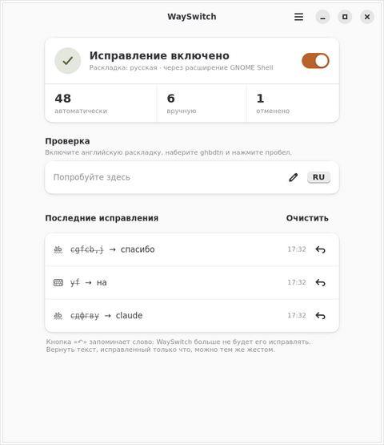

<p align="center">
  
</p>

<h1 align="center">WaySwitch</h1>

<p align="center">
  Исправляет слова, набранные не в той раскладке, — на Wayland, в GNOME и KDE Plasma.<br>
  <code>ghbdtn</code> + пробел → «привет», раскладка переключается сама.
</p>

<p align="center">
  <b>Русский</b> · <a href="README.en.md">English</a>
</p>

<p align="center">
  <a href="https://github.com/Wetoshkin/WaySwitch/releases"></a>
  <a href="https://github.com/Wetoshkin/WaySwitch/actions/workflows/ci.yml"></a>
  
  <a href="LICENSE"></a>
</p>

<p align="center">
  
  &nbsp;
  
</p>

---

На X11 такие программы давно есть (Punto Switcher, Caramba Switcher, xneur).
На Wayland композитор намеренно не даёт программам ни слушать чужую
клавиатуру, ни подделывать ввод, поэтому привычные утилиты там не работают.
WaySwitch работает уровнем ниже: читает клавиатуру из `/dev/input` (evdev) и
печатает через виртуальную клавиатуру ядра (uinput). Раскладку переключает
своё расширение GNOME Shell или KWin в KDE. Клавиатуру демон не захватывает:
если он зависнет, ввод продолжит работать.

## Что умеет

| | |
|---|---|
| **Автоисправление на пробеле** | `ghbdtn` → «привет», `руддщ` → `hello`. Словарь на 48 тыс. слов и символьные триграммы; цифры, пути, URL, camelCase и аббревиатуры не трогаются |
| **Ручное исправление** | двойной Shift — последнее слово, тройной — вся фраза. Вместо двойного Shift можно выбрать одну клавишу (правый Ctrl, ScrollLock, F-клавиша…) или Pause |
| **Исправить выделенное** | выделите фразу, набранную не в той раскладке, — и одной клавишей получите её в правильной. Клавиша — любая на выбор, или сочетание системы на команду `wayswitch fix-selection` |
| **Отмена с обучением** | тот же жест в течение 5 с после автоисправления возвращает слово и запоминает его: больше WaySwitch его не тронет |
| **Мелкие опечатки** | `пирогб` → «пирог,» (запятая из другой раскладки), `чтото` → «что-то», `кембы` → «кем бы», `сонатуБаха` → «сонату Баха», `ПРивет` → «Привет» |
| **Исключения** | слова и программы, где ничего не исправлять (Telegram, терминал, IDE). Поля паролей пропускаются |
| **Пауза после правки** | секунду после Backspace, стрелок и ручной смены раскладки автоисправление не вмешивается |
| **Значок в панели** | состояние, пауза, «исправить последнее слово», «исправить выделенное» |
| **Сообщает о новых версиях** | раз в сутки спрашивает GitHub; отключается |

Ничего не отправляется в сеть, кроме анонимного запроса «какая последняя
версия» (и его можно выключить). Исправленные слова не пишутся в журнал.

## Установка

Нужно: **Wayland** (не X11), **GNOME 46–51** или **KDE Plasma 6**, ровно две
раскладки — русская и английская. Проверить: «Параметры → О системе» —
оконная система Wayland.

<details open>
<summary><b>Arch, CachyOS, Manjaro, Fedora — из исходников</b></summary>

```bash
git clone https://github.com/Wetoshkin/WaySwitch.git
cd WaySwitch
sudo packaging/install.sh
```

Скрипт ставит зависимости (`pacman`/`dnf`/`apt`), копирует программу в
`/usr/local`, кладёт правило udev, службу systemd и расширение GNOME Shell
(и сразу включает его). После этого **выйдите из сеанса и войдите снова**.

</details>

<details>
<summary><b>Ubuntu, Debian — пакет .deb</b></summary>

```bash
url=$(curl -s "https://api.github.com/repos/Wetoshkin/WaySwitch/releases?per_page=1" | grep -o 'https://[^"]*\.deb' | head -1)
wget "$url"
sudo apt install ./wayswitch_*.deb
gnome-extensions enable wayswitch@siberia.ru
```

Затем **выйдите из сеанса и войдите снова**.

</details>

После входа откройте **WaySwitch** из меню приложений. Первый запуск
проверит систему, подскажет, что исправить, и включит службу.

<p align="center">
  
  &nbsp;
  
</p>

<details>
<summary>Впервые в терминале? Пара подсказок</summary>

- Терминал открывается так: клавиша Super (с логотипом), набрать «Терминал».
- Вставить текст в терминал — **Ctrl+Shift+V**.
- `sudo` спросит пароль вашей учётной записи; пока вы его набираете, на
  экране ничего не появляется — это нормально.
- Две раскладки добавляются в «Параметры → Клавиатура → Источники ввода».

</details>

## Обновление

**Как узнать о новой версии.** WaySwitch раз в сутки спрашивает GitHub,
вышла ли новая версия. Если вышла — в окне появится полоса «Вышла версия …»,
в меню значка — пункт с номером версии, и один раз придёт системное
уведомление. Выключается в «Параметры → Система → Сообщать о новых версиях».
Ещё способ — подписаться на релизы на GitHub: **Watch → Custom → Releases**.

**Как обновиться:**

```bash
# из исходников (Arch, CachyOS, Fedora)
cd WaySwitch && git pull && sudo packaging/install.sh

# .deb — скачать новый пакет и поставить поверх
sudo apt install ./wayswitch_<версия>_all.deb
```

Настройки и исключения при обновлении сохраняются. Если обновилось
расширение GNOME Shell, выйдите из сеанса и войдите снова: Shell держит
загруженную старую копию до перелогина.

## Использование

Наберите в любом поле `ghbdtn` и пробел — получится «привет». То же можно
проверить прямо в окне WaySwitch, в поле «Попробуйте здесь».

| Что сделать | Как |
|---|---|
| Исправить последнее слово вручную | двойной Shift (или своя клавиша из Параметров) |
| Исправить всю фразу | тройной Shift |
| Отменить автоисправление и запомнить слово | тот же жест в течение 5 с |
| Исправить выделенный текст | своя клавиша (Параметры → Вручную), пункт в меню значка или `wayswitch fix-selection` на сочетание системы |
| Пауза | переключатель в окне, Ctrl+P, меню значка, `wayswitch pause` |
| Параметры / Жесты и клавиши | Ctrl+, / Ctrl+? |

<details>
<summary>Команды терминала</summary>

| Команда | Что делает |
|---|---|
| `wayswitch doctor` | проверка системы: что работает, чего не хватает, как исправить |
| `wayswitch status` | состояние службы |
| `wayswitch pause` / `resume` | пауза / продолжить |
| `wayswitch fix` | исправить последнее слово |
| `wayswitch fix-selection` | исправить выделенный текст |
| `wayswitch dry-run` | служба в режиме наблюдения: решения пишутся в журнал, на экране ничего не меняется |
| `wayswitch devices` | устройства ввода |
| `wayswitch-gui [--tray]` | окно; `--tray` — только значок в панели |
| `journalctl --user -u wayswitch -n 50` | журнал службы |

</details>

<details>
<summary>Файл настроек</summary>

Всё настраивается в окне, но можно и руками:
`~/.config/wayswitch/config.toml` (служба перечитывает его сама).

```toml
[general]
auto_correct = true           # исправлять на пробеле
sensitivity = "normal"        # conservative | normal | aggressive
undo_window_sec = 5.0         # время на отмену жестом, с
edit_guard_sec = 1.0          # пауза после Backspace/стрелок/ручной смены раскладки, с
punct_fix = true              # «пирогб» → «пирог,»
particles_fix = true          # «чтото» → «что-то», «кембы» → «кем бы»
split_words_fix = true        # «сонатуБаха» → «сонату Баха»
two_capitals_fix = true       # «ПРивет» → «Привет»
skip_password_fields = true   # не исправлять в полях пароля
sound_on_fix = false          # звук при исправлении
check_updates = true          # раз в сутки спрашивать GitHub о новой версии

[gesture]
manual = "double_shift"       # double_shift | tap_key | pause_key | none
tap_key = "leftctrl"          # клавиша для tap_key
selection_key = ""            # клавиша «Исправить выделенное» (пусто — нет)

[typing]
settle_ms = 120               # ожидание после смены раскладки, мс
key_delay_ms = 0              # задержка между символами, мс

[backend]
prefer = "auto"               # auto | shell | kde | ibus | hotkey
```

Слова-исключения — `~/.config/wayswitch/exceptions.txt`, программы —
`~/.config/wayswitch/apps.txt` (по одной в строке, сравнение по части имени
без учёта регистра: `telegram` подойдёт и для `TelegramDesktop`).

</details>

## Если что-то не работает

1. `wayswitch doctor` — покажет, чего не хватает, и как это исправить.
2. В окне WaySwitch: меню → «О WaySwitch» → «Устранение неполадок» —
   сведения, которые удобно приложить к issue.
3. Частые случаи:
   - **Пропадает пробел после исправленного слова** — Параметры → Система →
     Дополнительно → увеличьте «Ожидание после смены раскладки» до 150–200 мс.
   - **Раскладка не переключается в GNOME** — включено ли расширение
     (`gnome-extensions enable wayswitch@siberia.ru`) и был ли перелогин.
   - **«Нет доступа к клавиатуре»** — перелогиньтесь: права на устройства
     ввода выдаются новому сеансу.
4. Не помогло — [заведите issue](https://github.com/Wetoshkin/WaySwitch/issues)
   и приложите вывод `wayswitch doctor` и `journalctl --user -u wayswitch -n 100`.

## Что важно знать

- **Доступ к клавиатуре.** Правило udev даёт программам вашего сеанса чтение
  событий клавиатуры — иначе WaySwitch не увидел бы набор. Это та же цена,
  что у любого переключателя раскладки на Wayland: доверяйте только
  программам, которые ставите сами. WaySwitch не пишет набранный текст ни в
  файлы, ни в журнал и не отправляет его в сеть.
- **Мост доступности (at-spi).** Чтобы знать, в какой программе вы печатаете
  и не поле ли это пароля, установщик включает `toolkit-accessibility`
  (прежнее значение возвращает `uninstall.sh`). Не хотите — ставьте с
  `--no-a11y`: всё остальное работает, только исключения по программам и
  защита паролей — нет.
- **Где проверено.** CachyOS, GNOME 51, Wayland — работает. KDE Plasma 6
  покрыт тестами, но живьём пока не проверялся. В Sway, Hyprland и других
  средах раскладку прочитать нечем — автоисправление там недоступно.
- **Расширение GNOME Shell** печатает только по запросу самого WaySwitch:
  другие программы на шине им воспользоваться не могут.

## Удаление

```bash
sudo packaging/uninstall.sh      # если ставили из исходников
sudo apt remove wayswitch        # если ставили .deb
```

Настройки в `~/.config/wayswitch` остаются; удалить их: `rm -rf ~/.config/wayswitch`.

## Как это устроено

```
/dev/input (evdev) → буфер слова → детектор (словарь + триграммы + правила)
      → план: переключить раскладку → стереть слово → напечатать
      → расширение GNOME Shell / KWin + uinput
```

Решение «исправить или оставить» принимается по двум гипотезам: что набрано
в текущей раскладке и что получилось бы в другой. Раскладки строятся из
настоящих раскладок системы через libxkbcommon, а не зашиты в код. На
отложенной части словаря: полнота 96,5 % (ru) и 96,8 % (en), ложные
срабатывания 0,07 %.

Подробности — в [спецификации](docs/superpowers/specs/2026-09-23-wayswitch-v2-design.md),
карта модулей — в [CLAUDE.md](CLAUDE.md).

## Разработка

```bash
pip install pytest ruff
python -m pytest -q
python -m ruff check .
```

Логика (детектор, буфер, контроллер, исполнитель) не импортирует GTK и
evdev на уровне модуля и тестируется где угодно, включая Windows.
Окно — GTK4/libadwaita; его тексты и модели тоже покрыты тестами без
дисплея. Живой прогон правил без окон: `PYTHONPATH=. python3 tools/live_rules.py`.
Пакет: `bash tools/build_deb.sh`; релиз — по тегу `vX.Y.Z`, совпадающему с
версией в `pyproject.toml`.

## Лицензия

Код — [MIT](LICENSE). Словари в `wayswitch/data` собраны из
[FrequencyWords](https://github.com/hermitdave/FrequencyWords)
(OpenSubtitles) — CC-BY-SA 4.0, см. `wayswitch/data/LICENSE`.
