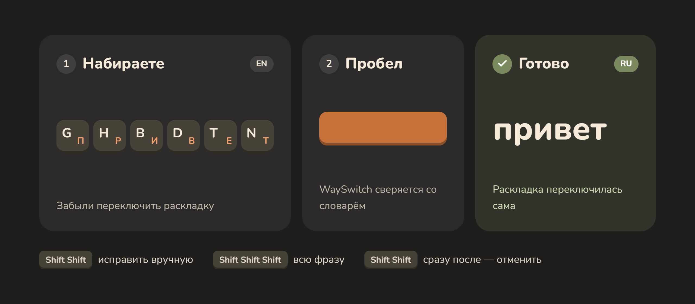
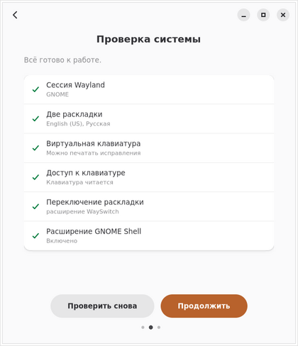

<p align="center">
  
</p>

<p align="center">
  <a href="https://github.com/Wetoshkin/WaySwitch/releases"></a>
  <a href="https://github.com/Wetoshkin/WaySwitch/actions/workflows/ci.yml"></a>
  
  
  
  <a href="LICENSE"></a>
</p>

<p align="center">
  <b>Русский</b> · <a href="README.en.md">English</a>
</p>

<p align="center">
  <a href="#установка">Установка</a> ·
  <a href="#первые-шаги">Первые шаги</a> ·
  <a href="#жесты">Жесты</a> ·
  <a href="#настройка">Настройка</a> ·
  <a href="#обновление">Обновление</a> ·
  <a href="#если-что-то-не-работает">Если не работает</a>
</p>

**Современная замена Punto Switcher и Caramba Switcher для Linux на Wayland.**

WaySwitch чинит слово, набранное не в той раскладке (`ghbdtn` вместо
«привет»), сразу же, на пробеле — без горячих клавиш и без переключения
раскладки вручную. Работает под Wayland в GNOME (Ubuntu, Fedora), KDE Plasma,
Sway, Hyprland, а также в Xfce, MATE, Budgie и LXQt — там, где обычные утилиты
такого рода не могут ни слушать клавиатуру, ни печатать за пользователя.
**Linux Mint (Cinnamon) пока не поддерживается.**

<p align="center">
  
</p>

## Возможности

- **Исправление на пробеле.** Набрали `ghbdtn ` — само становится
  `привет `, раскладка переключается вместе со словом. Цифры, пути, адреса,
  `camelCase` и аббревиатуры не трогаются.
- **Адреса сразу.** Начали URL не в той раскладке — `реезыЖ..` — WaySwitch
  узнаёт схему и чинит её, не дожидаясь пробела.
- **Ручное исправление.** Двойной Shift чинит последнее слово, тройной —
  всю фразу. Вместо Shift можно выбрать одну клавишу: правый Ctrl,
  ScrollLock, F-клавишу.
- **Исправить выделенное.** Выделите фразу, набранную не в той раскладке, и
  нажмите свою клавишу — фраза станет правильной.
- **Отмена с запоминанием.** Тот же жест сразу после автоисправления
  возвращает слово и больше его не трогает.
- **Мелкие опечатки** (каждую можно выключить в Параметрах):
  - две заглавные в начале слова — Shift отпустили поздно: `ПРивет` → «Привет»;
  - знак на месте последней буквы — в русской раскладке «б» и «ю» стоят на
    клавишах запятой и точки: `пирогб` → «пирог,»;
  - частицы слитно: `чтото` → «что-то», `скажика` → «скажи-ка»,
    `кембы` → «кем бы»;
  - пропущенный пробел перед словом с заглавной: `сонатуБаха` → «сонату Баха».
- **Исключения.** Слова и программы, где ничего не исправлять (терминал,
  мессенджер, IDE). Поля паролей пропускаются.

<p align="center">
  
  &nbsp;
  
</p>

##  Установка

**Что нужно:** Ubuntu 24.04 или новее (или Kubuntu, Debian 13, Fedora 41+,
openSUSE Tumbleweed, Arch и производные) и две раскладки — русская и
английская. Сомневаетесь — просто запустите команду ниже: она сама проверит
систему и скажет, если что-то не подходит.

### Одной командой

1. Откройте терминал: нажмите клавишу с логотипом Windows (в Linux она
   называется <kbd>Super</kbd>) и наберите «Терминал». В KDE он называется
   **Konsole**.
2. Скопируйте команду ниже, вставьте её в терминал сочетанием
   <kbd>Ctrl</kbd>+<kbd>Shift</kbd>+<kbd>V</kbd> (обычное
   <kbd>Ctrl</kbd>+<kbd>V</kbd> в терминале не работает) и нажмите
   <kbd>Enter</kbd>:

   ```bash
   curl -fsSL https://raw.githubusercontent.com/Wetoshkin/WaySwitch/main/packaging/get.sh | sh
   ```

   Если в ответ написано «curl: команда не найдена» (так бывает в Ubuntu и
   Linux Mint), сначала вставьте `sudo apt install -y curl`, нажмите
   <kbd>Enter</kbd>, введите пароль — и потом повторите команду выше.

3. Скрипт определит ваш дистрибутив, напишет, что собирается сделать, и
   спросит подтверждение — нажмите <kbd>Enter</kbd>. Потом он попросит
   пароль от вашей учётной записи. Пока вы его вводите, на экране ничего не
   появляется — так и должно быть.
4. **Перезагрузите компьютер** (сначала сохраните открытые документы).
   После этого WaySwitch запустится сам. Откройте его один раз из меню
   приложений: он проверит систему и подскажет, если чего-то не хватает.

> [!NOTE]
> Без вашего подтверждения скрипт ничего не устанавливает. Посмотреть, что
> внутри, можно здесь: [packaging/get.sh](packaging/get.sh).

<details>
<summary><b>Что скрипт сделает в моём дистрибутиве</b></summary>

| Дистрибутив | Что произойдёт |
|---|---|
| Ubuntu 24.04+, Kubuntu, Debian 13, KDE neon, Zorin OS 18 и другие на базе Debian | скачает `.deb` из последнего релиза и установит через `apt` |
| Fedora 41+ (Workstation и KDE) | установит `.rpm` через `dnf` |
| Fedora Silverblue, Kinoite, Bazzite и другие atomic-системы | добавит `.rpm` через `rpm-ostree`; после этого нужно перезагрузиться |
| openSUSE Tumbleweed и Slowroll | установит `.rpm` через `zypper` |
| Arch, CachyOS, EndeavourOS, Manjaro | поставит пакет из AUR через `paru` или `yay`, если он там есть; иначе соберёт из исходников |
| Остальные | установит из исходников через `packaging/install.sh` |

Во всех случаях скрипт включает автозапуск (`systemctl --user enable
wayswitch`), а в GNOME — расширение WaySwitch.

</details>

<details>
<summary><b>Установить вручную, без скрипта</b></summary>

Скачайте пакет со страницы
[Releases](https://github.com/Wetoshkin/WaySwitch/releases) — файл окажется
в папке «Загрузки». Затем выполните команду для своего дистрибутива.

**Ubuntu, Debian и производные** — файл `wayswitch_…_all.deb`:

```bash
sudo apt install "$(xdg-user-dir DOWNLOAD)"/wayswitch_*.deb
```

**Fedora** — файл `wayswitch-….noarch.rpm`:

```bash
sudo dnf install "$(xdg-user-dir DOWNLOAD)"/wayswitch-*.rpm
```

**Fedora Silverblue, Kinoite, Bazzite** — тот же `.rpm`, затем перезагрузка:

```bash
sudo rpm-ostree install "$(xdg-user-dir DOWNLOAD)"/wayswitch-*.rpm
systemctl reboot
```

**openSUSE** — тот же `.rpm`:

```bash
sudo zypper install --allow-unsigned-rpm "$(xdg-user-dir DOWNLOAD)"/wayswitch-*.rpm
```

**Arch, CachyOS, EndeavourOS, Manjaro** — пакет из [PKGBUILD](packaging/arch/PKGBUILD)
или из исходников:

```bash
sudo pacman -S --needed git
git clone https://github.com/Wetoshkin/WaySwitch.git
cd WaySwitch
sudo packaging/install.sh
```

После установки включите автозапуск и перезагрузите компьютер:

```bash
systemctl --user enable wayswitch
gnome-extensions enable wayswitch@siberia.ru   # только в GNOME
```

</details>

<details>
<summary><b>Если установка не получилась</b></summary>

**«Could not resolve host» или «Failed to connect».** Компьютер не может
связаться с GitHub. Проверьте, что в браузере открывается любой сайт, и
вставьте команду ещё раз: ничего не установилось, повторять безопасно.

**«curl: команда не найдена».** Установите curl и повторите:
`sudo apt install curl` (Ubuntu, Debian), `sudo dnf install curl`
(Fedora), `sudo zypper install curl` (openSUSE), `sudo pacman -S curl`
(Arch и производные).

**«Включён старый режим графики X11».** В нём WaySwitch не работает.
Выйдите из системы; на экране входа нажмите на своё имя, затем на значок
шестерёнки в правом нижнем углу и выберите «Ubuntu» или «GNOME» (не «on
Xorg»); в KDE — «Plasma (Wayland)» внизу слева. Войдите и запустите команду
снова.

**Слова не исправляются после установки.** Проверьте три вещи: вы
перезагрузили компьютер; раскладок ровно две — русская и английская
(Ubuntu: «Настройки → Клавиатура → Источники ввода», KDE: «Параметры
системы → Клавиатура → Раскладки», Sway и Hyprland: `xkb_layout` /
`kb_layout` в конфиге) — если их три и больше, лишние нужно убрать; в окне
WaySwitch (меню <kbd>☰</kbd> → «О WaySwitch» → «Устранение неполадок») в конце
написано «Всё готово.».

</details>

<details>
<summary><b>Удаление</b></summary>

```bash
curl -fsSL https://raw.githubusercontent.com/Wetoshkin/WaySwitch/main/packaging/get.sh | sh -s -- --uninstall
```

Скрипт сам определит, как WaySwitch был установлен. Настройки остаются в
`~/.config/wayswitch` на случай переустановки; стереть их:
`rm -rf ~/.config/wayswitch`.

</details>

##  Первые шаги

Откройте любое текстовое поле, переключитесь на английскую раскладку,
наберите `ghbdtn` и нажмите пробел — слово станет «привет», раскладка
переключится на русскую. В окне WaySwitch для этого есть поле «Проверка».

При первом запуске окно проверит систему. Где всё в порядке — зелёная
галочка, как на снимке ниже; где нет — подсказка, а часто и кнопка, которая
это исправит:

<p align="center">
  
</p>

##  Жесты

| Жест | Действие |
|---|---|
| <kbd>Shift</kbd> <kbd>Shift</kbd> | исправить последнее слово; если вы ещё ничего не набрали — просто переключить раскладку |
| <kbd>Shift</kbd> <kbd>Shift</kbd> <kbd>Shift</kbd> | исправить всю фразу |
| <kbd>Shift</kbd> <kbd>Shift</kbd> сразу после автоисправления | откатить слово и запомнить его как исключение |
| своя клавиша (Параметры → Вручную) | исправить выделенный текст |

Нажатия — подряд, второе в пределах 0,4 с. Вместо двойного Shift можно
выбрать одну клавишу. Жесты не работают, пока экран заблокирован или
WaySwitch на паузе. Посмотреть все жесты в окне — меню <kbd>☰</kbd> →
«Жесты и клавиши».

##  Настройка

Всё настраивается мышью, файл конфигурации править не нужно. Изменения
применяются сразу.

**GNOME, Xfce, MATE, Budgie, LXQt, KDE.** Откройте «WaySwitch» из
меню приложений (в Xfce, LXQt и MATE он есть и в центре настроек). В окне —
состояние, поле для проверки и последние исправления; параметры — в меню
<kbd>☰</kbd> или <kbd>Ctrl</kbd>+<kbd>,</kbd>. Значок в панели показывает
состояние и даёт поставить паузу.

**Sway и Hyprland.** Индикатор — модуль Waybar, управление — команды на
горячих клавишах, параметры — окно `wayswitch gui`. Готовые фрагменты
конфигов копируются в окне: «Параметры → Система → Панель».

<details>
<summary><b>Фрагменты для Waybar, Hyprland и Sway</b></summary>

`~/.config/waybar/config.jsonc` — добавьте `"custom/wayswitch"` в `modules-right`:

```jsonc
"custom/wayswitch": {
  "exec": "wayswitch waybar",
  "return-type": "json",
  "on-click": "wayswitch toggle",
  "on-click-right": "wayswitch gui"
}
```

`~/.config/waybar/style.css`:

```css
#custom-wayswitch        { padding: 0 10px; border-radius: 7px; }
#custom-wayswitch.fixed  { background: #c46a32; color: #fff; }
#custom-wayswitch.undone { background: rgba(143,160,115,.3); }
#custom-wayswitch.paused { opacity: .5; }
#custom-wayswitch.off    { color: #ff7b63; }
```

`~/.config/hypr/hyprland.conf`:

```ini
input {
    kb_layout = us,ru
}
bind = SUPER SHIFT, W, exec, wayswitch toggle
windowrule = float, class:^(ru\.siberia\.WaySwitch\.Settings)$
windowrule = size 640 740, class:^(ru\.siberia\.WaySwitch\.Settings)$
```

`~/.config/sway/config`:

```
input type:keyboard {
    xkb_layout us,ru
}
bindsym $mod+Shift+w exec wayswitch toggle
for_window [app_id="ru.siberia.WaySwitch.Settings"] floating enable, resize set 640 740
```

Последнее слово исправляется жестом (двойной Shift или своя клавиша) — он
работает везде. Отдельную горячую клавишу для `wayswitch fix` не назначайте:
сочетания с Super и щелчки по панели сбрасывают набранное слово.

Sway и обычный Hyprland не запускают пользовательские службы systemd сами.
Добавьте автозапуск в конфиг: `exec wayswitch run` (Sway) или
`exec-once = wayswitch run` (Hyprland). С uwsm это не нужно.

</details>

<details>
<summary><b>Xfce, MATE, Budgie, LXQt: раскладки композитора</b></summary>

В Wayland эти окружения работают поверх композитора labwc или Wayfire,
и раскладки задаются в его настройках. WaySwitch читает их оттуда и
переключает тем же сочетанием клавиш:

```ini
# ~/.config/labwc/environment
XKB_DEFAULT_LAYOUT=us,ru
XKB_DEFAULT_OPTIONS=grp:alt_shift_toggle
```

```ini
# ~/.config/wayfire.ini
[input]
xkb_layout = us,ru
xkb_options = grp:alt_shift_toggle
```

Композитор не сообщает, какая раскладка сейчас включена, поэтому WaySwitch
считает нажатия сочетания. Если менять раскладку только клавиатурой, этому
можно доверять: «Параметры → Система → Исправлять автоматически по
счётчику». Без этого работают ручной жест и «Исправить выделенное».

</details>

<details>
<summary><b>Файл конфигурации</b></summary>

`~/.config/wayswitch/config.toml` (служба перечитывает его сама):

```toml
[general]
auto_correct = true           # исправлять на пробеле
sensitivity = "normal"        # conservative | normal | aggressive
undo_window_sec = 5.0         # время на отмену жестом, с
edit_guard_sec = 1.0          # пауза после Backspace, стрелок и ручной смены раскладки, с
punct_fix = true              # «пирогб» → «пирог,»
particles_fix = true          # «чтото» → «что-то», «кембы» → «кем бы»
split_words_fix = true        # «сонатуБаха» → «сонату Баха»
two_capitals_fix = true       # «ПРивет» → «Привет»
skip_password_fields = true   # не исправлять в полях пароля
sound_on_fix = false          # звук при исправлении
check_updates = true          # раз в сутки спрашивать GitHub о новой версии

[gesture]
manual = "double_shift"       # double_shift | tap_key | pause_key | none
tap_key = "leftctrl"          # клавиша для tap_key
selection_key = ""            # клавиша «Исправить выделенное» (пусто — нет)

[typing]
settle_ms = 120               # ожидание после смены раскладки, мс
key_delay_ms = 0              # задержка между символами, мс

[backend]
prefer = "auto"               # auto | shell | kde | sway | hyprland | compositor | ibus | hotkey
track_hotkey = false          # labwc/Wayfire: автоисправление по счётчику раскладки
```

Слова-исключения — `~/.config/wayswitch/exceptions.txt`, программы —
`~/.config/wayswitch/apps.txt` (по одной в строке; `telegram` подойдёт и для
`TelegramDesktop`).

</details>

## Обновление

**Как узнать о новой версии.** Раз в сутки WaySwitch спрашивает GitHub,
вышла ли новая версия. Если вышла — в окне появится полоса «Вышла версия …»,
в меню значка — пункт с номером версии, и один раз придёт уведомление.
Выключается в «Параметры → Система». Ещё способ — подписаться на релизы:
**Watch → Custom → Releases** вверху этой страницы.

**Как обновиться** — та же команда, что и для установки:

```bash
curl -fsSL https://raw.githubusercontent.com/Wetoshkin/WaySwitch/main/packaging/get.sh | sh
```

Настройки и исключения сохраняются. После обновления выйдите из сеанса и
войдите снова — так подхватится и новая версия расширения GNOME Shell.

##  Если что-то не работает

Проще всего без терминала: откройте окно WaySwitch → меню <kbd>☰</kbd> →
«О WaySwitch» → «Устранение неполадок». Там полный отчёт о проверке системы
с подсказками. Те же сведения дают команды ниже — их вводят в терминал,
как при установке.

| Команда | Что покажет |
|---|---|
| `wayswitch doctor` | что работает, чего не хватает и как это исправить |
| `journalctl --user -u wayswitch -n 50` | последние строки журнала |
| `wayswitch dry-run` | решения детектора, без изменений на экране |

**Слово исправилось, а не должно было.** Сразу нажмите
<kbd>Shift</kbd> <kbd>Shift</kbd> — слово вернётся и больше не будет
исправляться. Если мешает целая программа, добавьте её в исключения.

**Пропадает пробел после исправленного слова.** «Параметры → Система →
Дополнительно» — увеличьте «Ожидание после смены раскладки» до 150–200 мс.

**В GNOME нет значка в верхней панели.** В Ubuntu он есть сразу. В других
системах включите расширение «AppIndicator» в приложении «Расширения».

Не помогло — напишите разработчику на
[странице сообщений об ошибках](https://github.com/Wetoshkin/WaySwitch/issues/new)
(нужна бесплатная учётная запись GitHub). Приложите отчёт: в окне WaySwitch
меню <kbd>☰</kbd> → «О WaySwitch» → «Устранение неполадок» → кнопка
«Скопировать», затем вставьте его в сообщение.

> [!IMPORTANT]
> WaySwitch не исправляет в полях пароля, если программа сообщает, что это
> поле пароля. Так делают не все программы. Перед вводом пароля в необычном
> поле поставьте WaySwitch на паузу — в панели, <kbd>Ctrl</kbd>+<kbd>P</kbd>
> в окне или командой `wayswitch pause`.

<details>
<summary><b>Все команды</b></summary>

| Команда | Действие |
|---|---|
| `wayswitch doctor` | проверка системы |
| `wayswitch status [--json]` | состояние |
| `wayswitch pause` / `resume` / `toggle` | пауза, продолжить, переключить |
| `wayswitch fix` | исправить последнее слово (удобнее жестом) |
| `wayswitch fix-selection` | исправить выделенный текст |
| `wayswitch waybar` | поток JSON для модуля Waybar |
| `wayswitch gui` | открыть окно |
| `wayswitch dry-run` | служба в режиме наблюдения |
| `wayswitch devices` | устройства ввода |
| `wayswitch run [--verbose] [--config PATH]` | запустить службу вручную |
| `wayswitch-gui [--tray]` | окно; `--tray` — только значок в панели |

</details>

##  Как это устроено

<details>
<summary><b>evdev, uinput, словарь и триграммы</b></summary>

1. `evdev` слушает клавиатуры напрямую по `/dev/input/event*`, без захвата
   устройства и без прав root: правило udev с тегом `uaccess` выдаёт доступ
   пользователю активного сеанса.
2. Буфер копит коды клавиш текущего слова и фразы, отдельно отслеживает
   Shift и CapsLock.
3. На пробеле детектор декодирует нажатия в текущей и альтернативной
   раскладке по таблицам `libxkbcommon`, построенным из настоящих раскладок
   пользователя.
4. Решение принимается по словарю и модели символьных триграмм, со
   стоп-правилами для цифр, смешанных алфавитов, camelCase, путей и URL.
5. Исправление: переключение раскладки, Backspace и перепечатка. Раскладку
   переключает композитор: в GNOME — расширение WaySwitch, в KDE — D-Bus
   KWin, в Sway и Hyprland — их IPC, в средах на labwc и Wayfire — сочетание
   клавиш XKB. Первый Backspace — точка невозврата: начатое исправление
   всегда доводится до конца, слово не пропадает.

Демон никогда не захватывает клавиатуру — если он зависнет, клавиатура
продолжит работать как обычно. На отложенной части словаря: полнота 96,5 %
(ru) и 96,8 % (en), ложные срабатывания 0,07 %.

</details>

## Частые вопросы

**Это безопасно?** WaySwitch читает нажатия клавиш, иначе он не смог бы
исправлять слова. Набранный текст он никуда не пишет и не отправляет;
исправленные слова не попадают даже в журнал. В сеть уходит только
анонимный запрос «какая последняя версия» (и его можно выключить). Код
открыт — его можно проверить.

**Работает ли в X11?** Нет. WaySwitch сделан для Wayland; для X11 есть
другие утилиты.

**Почему нет Flatpak или Snap?** Программе нужен прямой доступ к
`/dev/input`, а песочница его не даёт.

**Будут ли другие языки?** Сейчас — русский и английский. Третьи языки
запланированы как подключаемые словари.

## Статус и ограничения

WaySwitch v2 — **альфа**. Проверено на CachyOS, GNOME 51. KDE Plasma 6,
Sway, Hyprland и среды на labwc/Wayfire покрыты тестами, но живьём пока не
проверялись — будем рады отчётам.

- Поля с автодополнением (например, адресная строка браузера) могут вести
  себя неожиданно при перепечатке.
- Правило udev `uaccess` даёт чтение событий клавиатуры любой программе
  текущего пользователя — это цена схемы на `evdev`.
- «Исправить выделенное» пока работает в GNOME (через расширение).
- В средах на labwc/Wayfire композитор не сообщает текущую раскладку —
  автоисправление там по счётчику и по желанию.

<details>
<summary><b>Планы</b></summary>

- Модуль «Исправление раскладки» в Параметрах системы KDE (виджет в лотке уже есть).
- «Исправить выделенное» в KDE, Sway и Hyprland.
- Третьи языки как подключаемый пакет словаря и триграмм.
- Привилегированный помощник вместо широкого правила `uaccess`.
- Пакет в AUR: [PKGBUILD](packaging/arch/PKGBUILD) готов, публикация — как только
  AUR снова откроет регистрацию (см. [docs/aur.md](docs/aur.md)). Пока на Arch
  ставится из исходников той же командой.

</details>

##  Разработка

```bash
pip install pytest ruff
python -m pytest -q
python -m ruff check .
```

| Задача | Команда |
|---|---|
| пересобрать словари | `python tools/build_data.py` |
| собрать `.deb` | `bash tools/build_deb.sh` |
| собрать `.rpm` | `bash tools/build_rpm.sh` |
| собрать пакет Arch | `cd packaging/arch && makepkg -si` |

Логика (детектор, буфер, контроллер, исполнитель) не импортирует GTK и
evdev на уровне модуля и тестируется где угодно, включая Windows. Карта
модулей — в [CLAUDE.md](CLAUDE.md), итоги последнего ревью —
[docs/review-pr1.md](docs/review-pr1.md). Релиз выпускается по тегу `vX.Y.Z`,
совпадающему с версией в `pyproject.toml`.

## Лицензии

Код — MIT ([`LICENSE`](LICENSE)). Словарные данные и триграммы
(`wayswitch/data/*.gz`) собраны из проекта
[FrequencyWords](https://github.com/hermitdave/FrequencyWords) и
распространяются по CC-BY-SA 4.0 — см. `wayswitch/data/LICENSE`.
