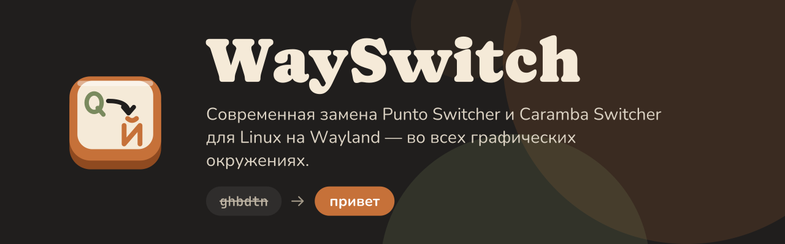
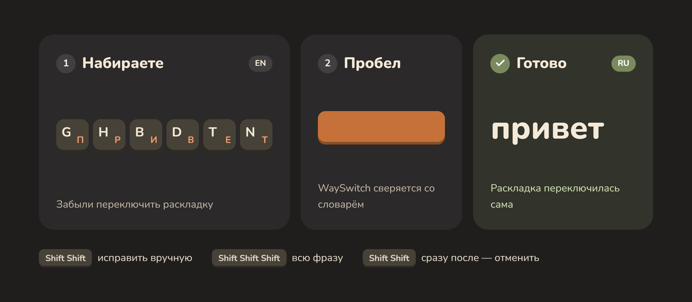
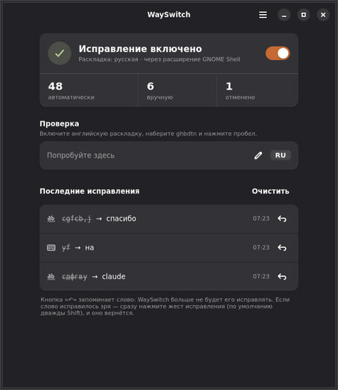
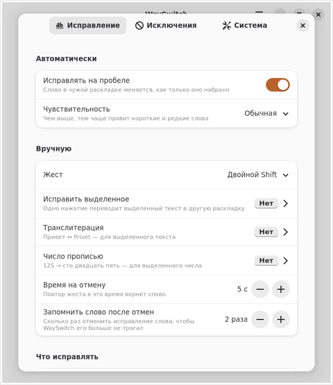
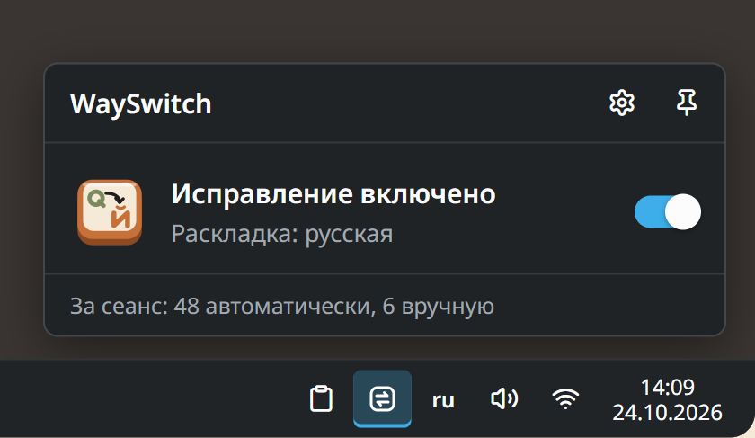
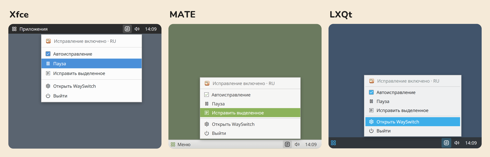
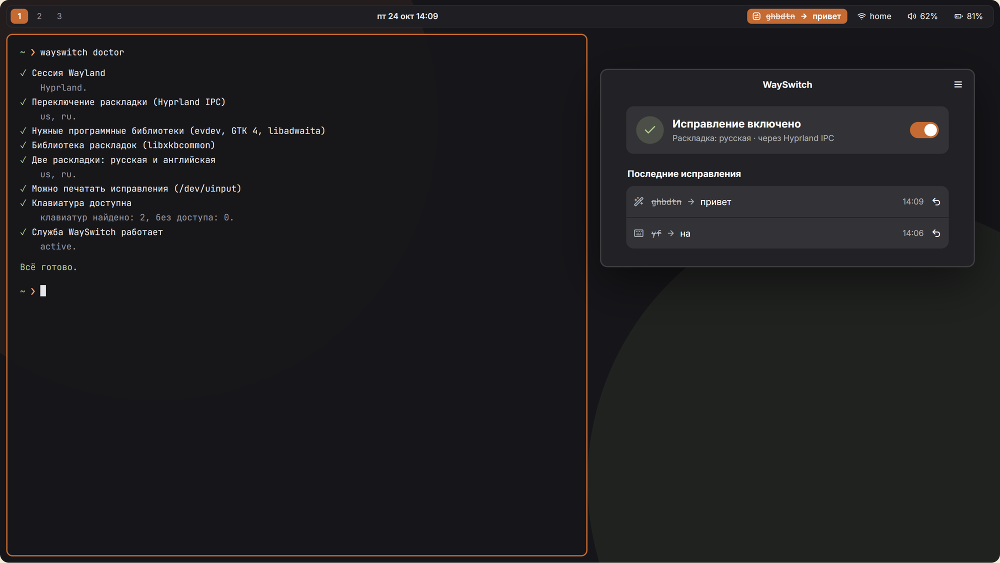
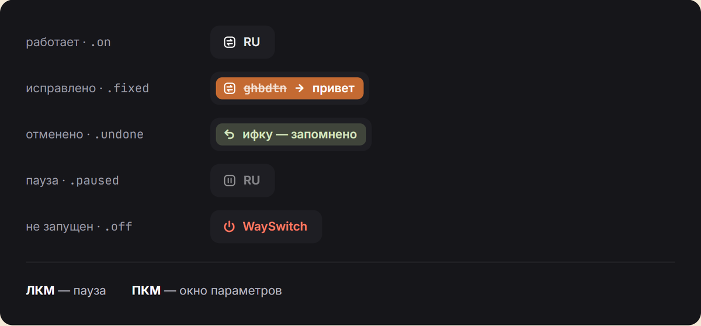
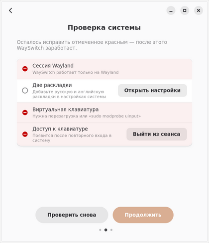

<p align="center">
  
</p>

<p align="center">
  
  
  
  
  
  
  
  <br>
  
  
  
  
  <a href="#статус-и-ограничения"></a>
  <a href="#статус-и-ограничения"></a>
  
  <a href="LICENSE"></a>
</p>

<p align="center">
  <b>Русский</b> · <a href="README.en.md">English</a>
</p>

<p align="center">
  <a href="#установка">Установка</a> ·
  <a href="#статус-и-ограничения">Совместимость</a> ·
  <a href="#первые-шаги">Первые шаги</a> ·
  <a href="#жесты">Жесты</a> ·
  <a href="#настройка">Настройка</a> ·
  <a href="#обновление">Обновление</a> ·
  <a href="#если-что-то-не-работает">Если не работает</a>
</p>

**Автоматическое исправление русско-английской раскладки для Linux на Wayland.**

**1.1.3 — исправления замены текста в GNOME, Hermes и Calc.**

Готовые пакеты и контрольные суммы: [последний опубликованный выпуск](https://github.com/Wetoshkin/WaySwitch/releases/latest).
Что уже сделано, проверено и ещё не закончено: [состояние проекта](docs/PROGRESS.md).

WaySwitch чинит слово, набранное не в той раскладке (`ghbdtn` вместо
«привет»), сразу же, на пробеле — без горячих клавиш и без переключения
раскладки вручную. Работает под Wayland в GNOME (Ubuntu, Fedora), COSMIC, KDE Plasma,
Sway и Hyprland. Для Xfce, MATE, Budgie и LXQt нужна Wayland-сессия на
labwc или Wayfire. Условия работы и проверки Umbriel/NixOS —
в [таблице совместимости](#статус-и-ограничения).
**X11 и Cinnamon (в том числе стандартный сеанс Linux Mint) не поддерживаются.**

<p align="center">
  
</p>

## Возможности

- **Исправление на пробеле.** Набрали `ghbdtn ` — само становится
  `привет `, раскладка переключается вместе со словом. Цифры, пути, адреса,
  `camelCase` и аббревиатуры не трогаются.
- **Слова с «е» и «ё».** Поиск по словарю не различает эти буквы
  (`небоскреб` ↔ `небоскрёб`), но в исправленном тексте остаётся та буква,
  которую набрали. Частые английские сокращения (`I'm`, `I'd`, `won't`,
  `don't`, `can't`) узнаются при смене раскладки; для самых коротких
  действуют обычные правила коротких слов.
- **По началу слова.** Если начало слова явно из другой раскладки —
  `ghbd` не начинает ни одного английского слова, зато так начинается
  «прив…» — WaySwitch может исправить начало и переключить раскладку
  до пробела. Это доступно при нативной замене диапазона в Writer/Calc.
  При перепечатке клавишами исправление ждёт пробела, чтобы продолжение
  набора не смешивалось с заменой. Это относится и к адресам (`реезыЖ..`).
- **Ручное исправление.** Двойной Shift чинит последнее слово, тройной —
  всю фразу. Вместо Shift можно выбрать одну клавишу: правый Ctrl,
  ScrollLock, F-клавишу.
- **Исправить выделенное.** Выделите фразу, набранную не в той раскладке, и
  нажмите свою клавишу — фраза станет правильной. Своими клавишами
  выделенное можно и **транслитерировать** (`Привет` ↔ `Privet`), и
  написать **число прописью** (`1 250` → «одна тысяча двести пятьдесят»).
  Проверено в поддерживаемых полях GNOME и KDE; нужен доступ через AT-SPI.
- **Отмена с запоминанием.** Тот же жест сразу после автоисправления
  возвращает слово. Отменили исправление того же слова второй раз — WaySwitch
  его запомнит и больше не тронет (сколько раз — настраивается).
- **Мелкие опечатки** (каждую можно выключить в Параметрах):
  - две заглавные в начале слова — Shift отпустили поздно: `ПРивет` → «Привет»;
  - нечаянно включённый Caps Lock: `пРИВЕТ` → «Привет», и Caps Lock
    выключается;
  - знак на месте последней буквы — в русской раскладке «б» и «ю» стоят на
    клавишах запятой и точки: `пирогб` → «пирог,»;
  - частицы слитно: `чтото` → «что-то», `скажика` → «скажи-ка»,
    `кембы` → «кем бы»;
  - пропущенный пробел перед словом с заглавной: `сонатуБаха` → «сонату Баха».
- **Исключения.** Слова и программы, где ничего не исправлять (терминал,
  мессенджер, IDE). Поля паролей пропускаются.

<p align="center">
  
  &nbsp;
  
</p>

### В других окружениях

Ниже — иллюстрации интеграций. Проверка с реальной клавиатурой в этих
окружениях ещё требуется; см. [статус и ограничения](#статус-и-ограничения).

**KDE Plasma** — виджет в системном лотке: состояние, раскладка, пауза одним
переключателем. Параметры открываются в том же окне WaySwitch.

<p align="center">
  
</p>

**Xfce, MATE, LXQt, Budgie** — значок в области уведомлений, меню у него
одинаковое во всех средах.

<p align="center">
  
</p>

**Sway и Hyprland** — модуль для Waybar: показывает раскладку и на
мгновение — что исправлено; щелчок ставит паузу, правый — открывает окно.

<p align="center">
  
</p>
<p align="center">
  
</p>

##  Установка

**Что нужно:** Wayland-сессия в одном из окружений выше, Ubuntu 24.04 или новее (или Kubuntu, Debian 13, Fedora 41+,
openSUSE Tumbleweed, Arch и производные). Для исправлений нужны русская и
английская раскладки. Другие источники можно оставить в системе: WaySwitch
не изменяет текст, пока выбрана другая раскладка, и возобновляет работу
после возврата в ru/en. Без пары ru/en приложение запускается с предупреждением.
Сомневаетесь — просто запустите команду ниже: она сама проверит
систему и скажет, если что-то не подходит.

**NixOS:** используйте отдельные [пакет и системный модуль](docs/nixos.md).
Команда ниже предназначена для остальных дистрибутивов.

### Одной командой

1. Откройте терминал: нажмите клавишу с логотипом Windows (в Linux она
   называется <kbd>Super</kbd>) и наберите «Терминал». В KDE он называется
   **Konsole**.
2. Скопируйте команду ниже, вставьте её в терминал сочетанием
   <kbd>Ctrl</kbd>+<kbd>Shift</kbd>+<kbd>V</kbd> (обычное
   <kbd>Ctrl</kbd>+<kbd>V</kbd> в терминале не работает) и нажмите
   <kbd>Enter</kbd>:

   ```bash
   curl -fsSL https://raw.githubusercontent.com/Wetoshkin/WaySwitch/main/packaging/get.sh | sh
   ```

   Если в ответ написано «curl: команда не найдена» (так бывает в Ubuntu и
   Linux Mint), сначала вставьте `sudo apt install -y curl`, нажмите
   <kbd>Enter</kbd>, введите пароль — и потом повторите команду выше.

3. Скрипт определит ваш дистрибутив, напишет, что собирается сделать, и
   спросит подтверждение — нажмите <kbd>Enter</kbd>. Потом он попросит
   пароль от вашей учётной записи. Пока вы его вводите, на экране ничего не
   появляется — так и должно быть.
4. **Перезагрузите компьютер** (сначала сохраните открытые документы).
   После этого WaySwitch запустится сам. Откройте его один раз из меню
   приложений: он проверит систему и подскажет, если чего-то не хватает.

> [!NOTE]
> Без вашего подтверждения скрипт ничего не устанавливает. Посмотреть, что
> внутри, можно здесь: [packaging/get.sh](packaging/get.sh).

Перед установкой `.deb` и `.rpm` скрипт проверяет SHA256 и размер скачанного
файла по метаданным выбранного релиза GitHub. Если проверка не проходит или
контрольная сумма отсутствует, установка останавливается. Для этой проверки
нужен `python3`; при его отсутствии скрипт подскажет, что установить.

<details>
<summary><b>Что скрипт сделает в моём дистрибутиве</b></summary>

| Дистрибутив | Что произойдёт |
|---|---|
| Ubuntu 24.04+, Kubuntu, Debian 13, KDE neon, Zorin OS 18 и другие на базе Debian | скачает `.deb` из последнего релиза и установит через `apt` |
| Fedora 41+ (Workstation и KDE) | установит `.rpm` через `dnf` |
| Fedora Silverblue, Kinoite, Bazzite и другие atomic-системы | добавит `.rpm` через `rpm-ostree`; после этого нужно перезагрузиться |
| openSUSE Tumbleweed и Slowroll | установит `.rpm` через `zypper` |
| Arch, CachyOS, EndeavourOS, Manjaro | поставит пакет из AUR через `paru` или `yay`, если он там есть; иначе соберёт из исходников |
| NixOS | используйте [пакет и системный модуль](docs/nixos.md), без общего установщика |
| Остальные | установит из исходников через `packaging/install.sh` |

Скрипт настраивает автозапуск, а в GNOME — расширение WaySwitch.
В Sway и Hyprland без uwsm добавьте запуск в конфиг композитора —
см. [настройку](#настройка).

</details>

<details>
<summary><b>Установить вручную, без скрипта</b></summary>

Скачайте пакет со страницы
[Releases](https://github.com/Wetoshkin/WaySwitch/releases) — файл окажется
в папке «Загрузки». Затем выполните команду для своего дистрибутива.

**Ubuntu, Debian и производные** — файл `wayswitch_…_all.deb`:

```bash
sudo apt install "$(xdg-user-dir DOWNLOAD)"/wayswitch_*.deb
```

**Fedora** — файл `wayswitch-….noarch.rpm`:

```bash
sudo dnf install "$(xdg-user-dir DOWNLOAD)"/wayswitch-*.rpm
```

**Fedora Silverblue, Kinoite, Bazzite** — тот же `.rpm`, затем перезагрузка:

```bash
sudo rpm-ostree install "$(xdg-user-dir DOWNLOAD)"/wayswitch-*.rpm
systemctl reboot
```

**openSUSE** — тот же `.rpm`:

```bash
sudo zypper install --allow-unsigned-rpm "$(xdg-user-dir DOWNLOAD)"/wayswitch-*.rpm
```

**Arch, CachyOS, EndeavourOS, Manjaro** — пакет из [PKGBUILD](packaging/arch/PKGBUILD)
или из исходников:

```bash
sudo pacman -S --needed git
git clone https://github.com/Wetoshkin/WaySwitch.git
cd WaySwitch
sudo packaging/install.sh
```

После установки включите автозапуск и перезагрузите компьютер:

```bash
systemctl --user enable wayswitch
gnome-extensions enable wayswitch@wetoshkin.github.io   # только в GNOME
```

</details>

<details>
<summary><b>Если установка не получилась</b></summary>

**«Could not resolve host» или «Failed to connect».** Компьютер не может
связаться с GitHub. Проверьте, что в браузере открывается любой сайт, и
вставьте команду ещё раз: ничего не установилось, повторять безопасно.

**«curl: команда не найдена».** Установите curl и повторите:
`sudo apt install curl` (Ubuntu, Debian), `sudo dnf install curl`
(Fedora), `sudo zypper install curl` (openSUSE), `sudo pacman -S curl`
(Arch и производные).

**«Включён старый режим графики X11».** В нём WaySwitch не работает.
Выйдите из системы; на экране входа нажмите на своё имя, затем на значок
шестерёнки в правом нижнем углу и выберите «Ubuntu» или «GNOME» (не «on
Xorg»); в KDE — «Plasma (Wayland)» внизу слева. Войдите и запустите команду
снова.

**Слова не исправляются после установки.** Проверьте три вещи: вы
перезагрузили компьютер; среди источников ввода есть русская и английская раскладки
(Ubuntu: «Настройки → Клавиатура → Источники ввода», KDE: «Параметры
системы → Клавиатура → Раскладки», Sway и Hyprland: `xkb_layout` /
`kb_layout` в конфиге) и сейчас выбрана одна из них — остальные удалять не нужно; в окне
WaySwitch (меню <kbd>☰</kbd> → «О WaySwitch» → «Устранение неполадок») в конце
написано «Обязательные проверки пройдены.». Этот итог подтверждает настройку
системы; для защищённого автоисправления также нужен достоверный фокус в поле
ввода. Если активное приложение не определено, запустите `sleep 5; wayswitch
doctor` и установите курсор в обычное текстовое поле нужной программы.
Пока фокус не подтверждён, ручное исправление остаётся доступным.

</details>

<details>
<summary><b>Удаление</b></summary>

```bash
curl -fsSL https://raw.githubusercontent.com/Wetoshkin/WaySwitch/main/packaging/get.sh | sh -s -- --uninstall
```

Скрипт сам определит, как WaySwitch был установлен. Настройки остаются в
`~/.config/wayswitch` на случай переустановки; стереть их:
`rm -rf ~/.config/wayswitch`.

</details>

### Flatpak и AppImage

Доступны два переносимых формата окна настроек. Клавиатуру читает и
исправляет текст отдельная нативная служба WaySwitch, установленная на хосте
командой выше. Используйте службу и окно из одного
[выпуска](https://github.com/Wetoshkin/WaySwitch/releases). Мастер первого запуска
объясняет установку службы, автозапуск и диагностику; настройки и пауза общие
для обоих компонентов.

Для локального Flatpak-пакета скачайте файл и `SHA256SUMS` из одного выпуска:

```bash
grep -E '^[[:xdigit:]]{64}  WaySwitch-Settings\.flatpak$' SHA256SUMS | sha256sum -c - && \
flatpak install --user --or-update ./WaySwitch-Settings.flatpak
flatpak run io.github.Wetoshkin.WaySwitch.Gui
```

Пакет предложит подключить официальный репозиторий для GNOME Runtime 50.
Для обновления скачайте новый файл, проверьте его по `SHA256SUMS` выпуска и
выполните `flatpak install --user --or-update ./WaySwitch-Settings.flatpak`.
Удаление окна: `flatpak uninstall --user io.github.Wetoshkin.WaySwitch.Gui`.
Публикация приложения на Flathub ещё не выполнена; `flatpak update` обновляет
окно после установки из настроенного репозитория, а не из отдельного файла.

AppImage рассчитан на Linux x86_64 с glibc 2.39+ (Ubuntu 24.04+, Debian 13+):

```bash
grep -E '^[[:xdigit:]]{64}  WaySwitch-Settings-x86_64\.AppImage$' SHA256SUMS | sha256sum -c - && \
chmod +x WaySwitch-Settings-x86_64.AppImage && \
./WaySwitch-Settings-x86_64.AppImage --appimage-extract-and-run
```

Python, GTK4 и libadwaita включены в AppImage. Для обновления закройте окно,
проверьте новый файл по `SHA256SUMS` и замените прежний. Для удаления достаточно
удалить файл. AppImage работает с правами пользователя; Flatpak использует
песочницу без доступа к устройствам ввода. Нативная служба и общие настройки
сохраняются при удалении любого переносимого окна.

### COSMIC

Настройте русскую и латинскую раскладки в COSMIC Settings. WaySwitch получает
фактическую карту и текущую группу через протокол композитора, без расширения
GNOME. Проверено в COSMIC 1.11 с несколькими клавиатурами одного seat;
несколько клавиатурных seats пока не поддерживаются.

**После запуска или перезапуска службы и после блокировки нужно явно включить
исправление** переключателем в окне, пунктом трея или `wayswitch resume`.
Экран сначала должен быть разблокирован. COSMIC не предоставляет надёжного
публичного подтверждения разблокировки, поэтому автоматического возобновления
нет. Если охрана не может проверить состояние, `wayswitch doctor` покажет
причину; исправление останется отключённым.

В COSMIC автоматическое выключение Caps Lock не выполняется: скомпилированная
карта не сообщает исходные XKB-опции, а Caps может быть назначен на другое действие.

### NixOS и Umbriel

Для NixOS подготовлены пакет и системный модуль; зависимости, доступ к
устройствам и запуск службы описаны в [руководстве](docs/nixos.md).
В Umbriel используется его IPC. Список и порядок раскладок должны быть одинаковыми у обычных
клавиатур и `uinput`, и графический сеанс, зарегистрированный в logind.
При неизвестном состоянии сеанса блокируются автоматическое и ручное исправление.
Автоматическое выключение Caps Lock недоступно без сведений об XKB-опциях.

При нескольких вариантах ru/en используется текущий вариант и первый
противоположный язык в системном списке. На GNOME для работы с дополнительными
источниками нужно расширение WaySwitch: резервный системный хоткей не даёт
достоверного состояния при трёх и более источниках. В labwc/Wayfire сохраняется
ограничение счётчика: переключение мышью ему не видно, авторежим требует
явного `backend.track_hotkey`. При дополнительных раскладках нужны обычные
циклические XKB-сочетания (например, `grp:alt_shift_toggle`); неоднозначные
двунаправленные сочетания оставляют службу в пассивном режиме.

### Удалённый рабочий стол (RDP)

WaySwitch читает устройства клавиатуры локального сеанса. Отдельный RDP-сеанс
не поддерживается: его ввод может не проходить через эти устройства, а права
`uaccess` выдаются активному локальному сеансу. Если `/dev/uinput` недоступен,
служба ждёт восстановления доступа и затем продолжает запуск автоматически.
Причину можно проверить командами `wayswitch doctor` и
`journalctl --user -u wayswitch -n 30`. При неверном правиле udev или отсутствии
модуля `uinput` ожидание продлится до устранения причины.

##  Первые шаги

Откройте обычное редактируемое поле, переключитесь на английскую раскладку,
наберите `ghbdtn` и нажмите пробел — слово станет «привет», раскладка
переключится на русскую. В окне WaySwitch для этого есть поле «Проверка».
Для автоматического исправления приложение должно сообщать достоверный фокус
через AT-SPI; терминалы по умолчанию пропускаются.

При первом запуске окно проверит систему. Где всё в порядке — зелёная
галочка, как на снимке ниже; где нет — подсказка, а часто и кнопка, которая
это исправит:

<p align="center">
  
</p>

##  Жесты

| Жест | Действие |
|---|---|
| <kbd>Shift</kbd> <kbd>Shift</kbd> | исправить последнее слово; если вы ещё ничего не набрали — просто переключить раскладку |
| <kbd>Shift</kbd> <kbd>Shift</kbd> <kbd>Shift</kbd> | исправить всю фразу |
| <kbd>Shift</kbd> <kbd>Shift</kbd> сразу после автоисправления | вернуть слово (со второго раза — запомнить его) |
| своя клавиша (Параметры → Вручную) | исправить выделенный текст, транслитерация, число прописью (GNOME) |

Нажатия — подряд, второе в пределах 0,4 с. Вместо двойного Shift можно
выбрать одну клавишу. Жесты не работают, пока экран заблокирован или
WaySwitch на паузе. Посмотреть все жесты в окне — меню <kbd>☰</kbd> →
«Жесты и клавиши».

##  Настройка

Всё настраивается мышью, файл конфигурации править не нужно. Изменения
применяются сразу.

**Язык интерфейса.** Окно, уведомления, значок и модуль Waybar выбирают язык
при запуске по `LANGUAGE`, `LC_ALL`, `LC_MESSAGES`, `LANG`. Русская локаль
даёт русский интерфейс; английская, `C`, `C.UTF-8`, `POSIX`, неизвестная или
отсутствующая — английский исходный. Для `C`/`POSIX` переменная `LANGUAGE`
не включает русский каталог. Виджет Plasma использует системный язык KDE.
Локализация ещё не вошла в опубликованный релиз.

**GNOME, COSMIC, Xfce, MATE, Budgie, LXQt, KDE.** Откройте «WaySwitch» из
меню приложений (в Xfce, LXQt и MATE он есть и в центре настроек). В окне —
состояние, поле для проверки и последние исправления; параметры — в меню
<kbd>☰</kbd> или <kbd>Ctrl</kbd>+<kbd>,</kbd>. Значок в панели показывает
состояние и даёт поставить паузу.

**Sway и Hyprland.** Индикатор — модуль Waybar, управление — команды на
горячих клавишах, параметры — окно `wayswitch gui`. Готовые фрагменты
конфигов копируются в окне: «Параметры → Система → Панель».

<details>
<summary><b>Фрагменты для Waybar, Hyprland и Sway</b></summary>

`~/.config/waybar/config.jsonc` — добавьте `"custom/wayswitch"` в `modules-right`:

```jsonc
"custom/wayswitch": {
  "exec": "wayswitch waybar",
  "return-type": "json",
  "on-click": "wayswitch toggle",
  "on-click-right": "wayswitch gui"
}
```

`~/.config/waybar/style.css`:

```css
#custom-wayswitch        { padding: 0 10px; border-radius: 7px; }
#custom-wayswitch.fixed  { background: #c46a32; color: #fff; }
#custom-wayswitch.undone { background: rgba(143,160,115,.3); }
#custom-wayswitch.paused { opacity: .5; }
#custom-wayswitch.off    { color: #ff7b63; }
```

`~/.config/hypr/hyprland.conf`:

```ini
input {
    kb_layout = us,ru
}
bind = SUPER SHIFT, W, exec, wayswitch toggle
windowrule = float, class:^(io\.github\.Wetoshkin\.WaySwitch\.Settings)$
windowrule = size 640 740, class:^(io\.github\.Wetoshkin\.WaySwitch\.Settings)$
```

`~/.config/sway/config`:

```
input type:keyboard {
    xkb_layout us,ru
}
bindsym $mod+Shift+w exec wayswitch toggle
for_window [app_id="io.github.Wetoshkin.WaySwitch.Settings"] floating enable, resize set 640 740
```

Последнее слово исправляется жестом (двойной Shift или своя клавиша) — он
работает во всех поддерживаемых окружениях при активной службе. Отдельную
горячую клавишу для `wayswitch fix` не назначайте: сочетания с Super и щелчки
по панели сбрасывают набранное слово.

Sway и обычный Hyprland не запускают пользовательские службы systemd сами.
Добавьте автозапуск в конфиг: `exec wayswitch run` (Sway) или
`exec-once = wayswitch run` (Hyprland). С uwsm это не нужно.

</details>

<details>
<summary><b>Xfce, MATE, Budgie, LXQt: раскладки композитора</b></summary>

В Wayland эти окружения работают поверх композитора labwc или Wayfire,
и раскладки задаются в его настройках. WaySwitch читает их оттуда и
переключает тем же сочетанием клавиш:

```ini
# ~/.config/labwc/environment
XKB_DEFAULT_LAYOUT=us,ru
XKB_DEFAULT_OPTIONS=grp:alt_shift_toggle
```

```ini
# ~/.config/wayfire.ini
[input]
xkb_layout = us,ru
xkb_options = grp:alt_shift_toggle
```

Композитор не сообщает, какая раскладка сейчас включена, поэтому WaySwitch
считает нажатия сочетания. Если менять раскладку только клавиатурой, этому
можно доверять: «Параметры → Система → Исправлять автоматически по
счётчику». Без этого доступен ручной жест для последнего слова. Выделение
через AT-SPI проверено в полях Qt, Kate/KWrite и Writer на KDE. Это не
подтверждает работу выделения в labwc/Wayfire.

</details>

<details>
<summary><b>Файл конфигурации</b></summary>

`~/.config/wayswitch/config.toml` (служба перечитывает его сама):

```toml
[general]
auto_correct = true           # исправлять на пробеле
sensitivity = "normal"        # conservative | normal | aggressive
undo_window_sec = 5.0         # время на отмену жестом, с
edit_guard_sec = 1.0          # пауза после Backspace, стрелок и ручной смены раскладки, с
punct_fix = true              # «пирогб» → «пирог,»
particles_fix = true          # «чтото» → «что-то», «кембы» → «кем бы»
split_words_fix = true        # «сонатуБаха» → «сонату Баха»
two_capitals_fix = true       # «ПРивет» → «Привет»
caps_fix = true               # «пРИВЕТ» → «Привет» и выключить Caps Lock
early_switch = true           # переключать раскладку по началу слова (не в conservative)
learn_after_undos = 2         # со скольких отмен запоминать слово, 1–5
skip_password_fields = true   # не автоисправлять парольные поля и терминалы
sound_on_fix = false          # звук при исправлении
check_updates = true          # раз в сутки спрашивать GitHub о новой версии

[gesture]
manual = "double_shift"       # double_shift | tap_key | pause_key | none
tap_key = "leftctrl"          # клавиша для tap_key
selection_key = ""            # клавиша «Исправить выделенное» (пусто — нет)
translit_key = ""             # клавиша транслитерации выделенного
numbers_key = ""              # клавиша «число прописью» для выделенного

[typing]
settle_ms = 120               # ожидание после смены раскладки, мс
key_delay_ms = 0              # задержка между символами, мс

[backend]
prefer = "auto"               # auto | shell | kde | cosmic | sway | hyprland | compositor | ibus | hotkey
track_hotkey = false          # labwc/Wayfire: автоисправление по счётчику раскладки
```

Слова-исключения — `~/.config/wayswitch/exceptions.txt`, программы —
`~/.config/wayswitch/apps.txt` (по одной в строке; `telegram` подойдёт и для
`TelegramDesktop`).

</details>

## Обновление

При переходе на пространство имён GitHub меняются идентификаторы расширения,
окна и переносимых пакетов. Порядок обновления Flatpak, GNOME и виджета KDE —
в [руководстве по переходу](docs/identifiers.md); настройки WaySwitch сохраняются.

**Как узнать о новой версии.** Раз в сутки WaySwitch спрашивает GitHub,
вышла ли новая версия. Если вышла — в окне появится полоса «Вышла версия …»
с кнопкой **«Обновить»**, такая же кнопка есть в уведомлении, в меню значка
и в «Параметры → Система». Проверка выключается там же. Ещё способ —
подписаться на релизы: **Watch → Custom → Releases** вверху этой страницы.

**Как обновиться.** Нажмите «Обновить»: откроется окно терминала, там
нужно подтвердить обновление и ввести пароль. Команду искать не нужно.
Без окна — та же команда, что и для установки:

```bash
curl -fsSL https://raw.githubusercontent.com/Wetoshkin/WaySwitch/main/packaging/get.sh | sh
```

Настройки и исключения сохраняются, перезагружаться не нужно: значок
перезапустится сам. В GNOME новая версия расширения заработает после
следующего входа в систему, а в Fedora Silverblue и Kinoite обновление
применяется после перезагрузки.

**Как удалить.** «Параметры → Система → Удалить WaySwitch» — откроется
терминал с командой удаления, как и при обновлении.

##  Если что-то не работает

Проще всего без терминала: откройте окно WaySwitch → меню <kbd>☰</kbd> →
«О WaySwitch» → «Устранение неполадок». Там полный отчёт о проверке системы
с подсказками. Те же сведения дают команды ниже — их вводят в терминал,
как при установке.

| Команда | Что покажет |
|---|---|
| `wayswitch doctor` | что работает, чего не хватает и как это исправить |
| `journalctl --user -u wayswitch -n 50` | последние строки журнала |
| `wayswitch dry-run` | решения детектора, без изменений на экране |

**Слово исправилось, а не должно было.** Сразу нажмите
<kbd>Shift</kbd> <kbd>Shift</kbd> — слово вернётся. По умолчанию оно попадает
в исключения после второй отмены; порог можно изменить в Параметрах.
Если мешает целая программа, добавьте её в исключения.

**Пропадает пробел после исправленного слова.** «Параметры → Система →
Дополнительно» — увеличьте «Ожидание после смены раскладки» до 150–200 мс.

**В GNOME нет значка в верхней панели.** В Ubuntu он есть сразу. В других
системах включите расширение «AppIndicator» в приложении «Расширения».
В обычной Fedora, если оно отсутствует, установите пакет
`sudo dnf install gnome-shell-extension-appindicator`. В Bazzite расширение
уже встроено; дополнительно устанавливать этот пакет не требуется.

Не помогло — напишите разработчику на
[странице сообщений об ошибках](https://github.com/Wetoshkin/WaySwitch/issues/new)
(нужна бесплатная учётная запись GitHub). Приложите отчёт: в окне WaySwitch
меню <kbd>☰</kbd> → «О WaySwitch» → «Устранение неполадок» → кнопка
«Скопировать», затем вставьте его в сообщение. Перед публикацией удалите
личные сведения: имена устройств, пути и данные сеанса. Набранные слова
не записываются в журнал, в том числе в режимах `--verbose` и `dry-run`.
Подробнее — [как сообщить об ошибке](CONTRIBUTING.md).

> [!IMPORTANT]
> WaySwitch не исправляет в полях пароля, если программа сообщает, что это
> поле пароля. Так делают не все программы. Перед вводом пароля в необычном
> поле поставьте WaySwitch на паузу — в панели, <kbd>Ctrl</kbd>+<kbd>P</kbd>
> в окне или командой `wayswitch pause`.

<details>
<summary><b>Все команды</b></summary>

| Команда | Действие |
|---|---|
| `wayswitch doctor` | проверка системы |
| `wayswitch status [--json]` | состояние |
| `wayswitch pause` / `resume` / `toggle` | пауза, продолжить, переключить |
| `wayswitch fix` | исправить последнее слово (удобнее жестом) |
| `wayswitch fix-selection` | исправить выделенный текст |
| `wayswitch translit` | транслитерация выделенного: Привет ↔ Privet |
| `wayswitch number-words` | выделенное число прописью |
| `wayswitch waybar` | поток JSON для модуля Waybar |
| `wayswitch gui` | открыть окно |
| `wayswitch dry-run` | служба в режиме наблюдения |
| `wayswitch devices` | устройства ввода |
| `wayswitch run [--verbose] [--config PATH]` | запустить службу вручную |
| `wayswitch-gui [--tray]` | окно; `--tray` — только значок в панели |

</details>

##  Как это устроено

<details>
<summary><b>evdev, uinput, словарь и триграммы</b></summary>

1. `evdev` слушает клавиатуры напрямую по `/dev/input/event*`, без захвата
   устройства и без прав root: правило udev с тегом `uaccess` выдаёт доступ
   пользователю активного сеанса.
2. Буфер копит коды клавиш текущего слова и фразы, отдельно отслеживает
   Shift и CapsLock.
3. На пробеле детектор декодирует нажатия в текущей и альтернативной
   раскладке по таблицам `libxkbcommon`, построенным из настоящих раскладок
   пользователя.
4. Решение принимается по словарю и модели символьных триграмм, со
   стоп-правилами для цифр, смешанных алфавитов, camelCase, путей и URL.
5. Исправление: переключение раскладки, Backspace и перепечатка. Раскладку
   переключает композитор: в GNOME — расширение WaySwitch, в KDE — D-Bus
   KWin, в Sway, Hyprland и Umbriel — их IPC, в средах на labwc и Wayfire — сочетание
   клавиш XKB. При перепечатке клавишами обнаруженный физический ввод останавливает
   дальнейшие изменения; слово может остаться изменённым частично. Физическая
   клавиша всё же может попасть между проверкой и отправкой виртуальной клавиши.

Демон никогда не захватывает клавиатуру — если он зависнет, клавиатура
продолжит работать как обычно. На отложенной части словаря: полнота 96,5 %
(ru) и 96,8 % (en), ложные срабатывания 0,07 %.

</details>

## Частые вопросы

**Что происходит с моими данными?** Исправление работает локально: набранный
текст не отправляется в сеть. Последние исправления хранятся в памяти окна;
слова-исключения, в том числе выученные после отмен, сохраняются в
`~/.config/wayswitch/exceptions.txt`. Журнал, включая `--verbose` и
`dry-run`, содержит решения и результаты операций без набранных слов.
При неизвестном или устаревшем фокусе текст исправления не передаётся
в историю окна по D-Bus и не используется для обучения после отмены.
Буфер, контекст и отмена привязаны к полю, где текст набран: программная смена
поля отбрасывает прежний ввод. Если достоверный фокус определился посреди слова,
непроверенный префикс не перепечатывается; исправление ждёт границу слова.

Проверка обновлений обращается к GitHub API: GitHub получает IP-адрес и
версию WaySwitch из `User-Agent`, но не введённый текст. Проверку можно
выключить в Параметрах. Доступ к клавиатуре и распознавание полей пароля
имеют ограничения, описанные в разделе ниже.

**Работает ли в X11?** Нет. WaySwitch сделан для Wayland; для X11 есть
другие утилиты.

**Flatpak и AppImage.** В этих форматах поставляется окно настроек с явной
установкой нативной службы на хосте — см. раздел установки. Демону нужны
`/dev/input`, `/dev/uinput`, правило udev и интеграция с рабочим столом.
Пакет Snap не подготовлен.

**Будут ли другие языки?** Сейчас — русский и английский. Третьи языки
запланированы как подключаемые словари.

## Статус и ограничения

Поддержка окружения не гарантирует совместимость каждого приложения:
автоматическое исправление зависит от доступности его полей через AT-SPI.

| Окружение | Интеграция и условия | Проверка |
|---|---|---|
| GNOME 46–51 | Расширение WaySwitch; резервный способ через IBus | Живые сеансы GNOME 50.1/51 на Ubuntu, CachyOS и Bazzite |
| KDE Plasma 6 | Раскладки через D-Bus KWin; виджет или значок в лотке | Plasma 6.6.6 Wayland в VM: Kate/KWrite, поля Qt/GTK и Konsole |
| COSMIC | Карта и текущая раскладка от композитора; после запуска и разблокировки нужно явно включить исправление | Живой сеанс COSMIC 1.11 |
| Sway, Hyprland | IPC композитора; индикатор Waybar | Автотесты; проверка с физической клавиатурой ещё нужна |
| labwc, Wayfire | XKB-конфиг и счётчик сочетания; авторежим включается отдельно | Автотесты; живая проверка ещё нужна |
| Xfce, MATE, Budgie, LXQt | Только Wayland-сессия на labwc/Wayfire; значок в области уведомлений | Те же ограничения, что у композитора |
| Umbriel | Нативный IPC, карта раскладки и защита сессии | Живой Wayland-сеанс Ubuntu: ввод, отмена, пароль, блокировка и смена VT |

**NixOS.** [Пакет и системный модуль](docs/nixos.md) входят в проект; сборка
и проверки зависимостей на Linux прошли. Живой графический сеанс NixOS
пока не проверен. Для исправления нужна пара ru/en; дополнительные раскладки
разрешены, при их выборе текст не меняется.

X11, Cinnamon и отдельные RDP-сеансы не поддерживаются.

Проверки приложений ниже относятся к GNOME, если не указано иное.
В KDE проверены Writer с KF6 и GTK3, выделение в Kate/KWrite и Writer.
Calc проверен с GTK3 VCL; тестирование KF6 ограничено сбоем плагина LibreOffice.

- В Writer проверены исправление в обе стороны, отмена после допечатывания,
  автозаглавные буквы и два слова подряд. В 1.1.3
  в Calc на GNOME 51.1 прошли восемь автозамен и восемь ручных исправлений:
  F2 и прямой ввод, медленный и быстрый набор. Детали — в состоянии проекта.
- В Chrome проверены обычные поля и редактируемые блоки страницы, пароли
  и readonly. В eXpress проверен исходный редактор сообщения на изолированном
  стенде без отправки; авторизованный чат пока не проверялся.
- В Firefox Flatpak на Bazzite проверены input, textarea, contenteditable
  и адресная строка. В 1.1.3 в нативном Telegram 7.4.1
  на GNOME 51.1 проверено поле сообщения авторизованного чата, обе раскладки,
  без отправки сообщений. Этот прогон не проверяет редактор Telegram Flatpak.
  В ONLYOFFICE Desktop Editors 10.0.0
  (Flatpak на Bazzite) на проверенном стенде дерево полей AT-SPI не появилось;
  автоматическое исправление не подтверждено. В отдельном контроле официального
  DEB на Ubuntu подключение к AT-SPI работало, но документ и поиск не предоставили
  редактируемых полей даже после включения поддержки экранного диктора.
- Для GridCraft 0.13.0 Flatpak требуется доступ к шине доступности:
  `flatpak override --user --talk-name=org.a11y.Bus ai.storyteller.gridcraft`.
  Сохраните таблицы и полностью перезапустите GridCraft после изменения.
  С этим разрешением в отдельном экземпляре прошли автозамены в обе стороны;
  для исправления ввода также нужна нативная служба WaySwitch.
- Поля с автодополнением (например, адресная строка браузера) могут вести
  себя неожиданно при перепечатке.
- При включённой защите полей пароля автоматическое исправление ждёт
  достоверного фокуса AT-SPI. Если доступность приложения не работает,
  используйте ручной жест. Идентификатор для исключений показывает
  `wayswitch doctor`; в GNOME обновите также расширение и перезайдите в сеанс.
- При включённой защите паролей автокоррекция в терминалах выключена целиком.
  Терминал не сообщает, когда скрывает пароль. Ручной жест доступен,
  ввод терминала не передаётся в историю исправлений и обучение.
- COSMIC проверен в настоящем Wayland-сеансе, включая
  исправление и блокировку. После старта службы и разблокировки требуется
  явное включение исправления; детали приведены в разделе установки.
- Правило udev `uaccess` даёт чтение событий клавиатуры любой программе
  активного локального пользователя. Оно также открывает мышь и тачпад
  для сброса буфера при клике и `uinput` для эмуляции ввода.
- Работа с выделением зависит от AT-SPI приложения; проверены поля GNOME и KDE.
- Совместимость LibreOffice и ряда Flatpak-приложений ещё дорабатывается:
  [LibreOffice и выделение](https://github.com/Wetoshkin/WaySwitch/issues/18),
  [Firefox, Telegram и ONLYOFFICE на Bazzite](https://github.com/Wetoshkin/WaySwitch/issues/19).
- В средах на labwc/Wayfire композитор не сообщает текущую раскладку —
  автоисправление там по счётчику и по желанию.


##  Разработка

```bash
python -m pip install pytest ruff
python -m pytest -q
python -m ruff check .
```

| Задача | Команда |
|---|---|
| пересобрать словари | `python tools/build_data.py` |
| пересобрать перевод | `msgfmt --check --check-format --no-hash -o wayswitch/locale/ru/LC_MESSAGES/wayswitch.mo wayswitch/locale/ru/LC_MESSAGES/wayswitch.po` |
| собрать `.deb` | `bash tools/build_deb.sh` |
| собрать `.rpm` | `bash tools/build_rpm.sh` |
| собрать пакет Arch | `cd packaging/arch && makepkg -si` |
| собрать окно Flatpak | `bash tools/build_flatpak.sh build/flatpak` (GNOME SDK/Platform 50) |
| собрать окно AppImage | `python3 tools/build_appimage.py build/appimage` (Linux x86_64, squashfs-tools, dpkg-deb) |

Flatpak распространяется через GitHub Releases; публикация на Flathub не выполнена.
Зависимость от нативной службы требует отдельного рассмотрения площадкой.
[Правила Flathub](https://docs.flathub.org/docs/for-app-authors/requirements)
запрещают созданные с помощью ИИ манифесты и подачу PR агентами.
Для возможной подачи владелец должен самостоятельно подготовить соответствующие
правилам материалы и согласовать допустимость обязательной службы на хосте.

Логика (детектор, буфер, контроллер, исполнитель) не импортирует GTK и
evdev на уровне модуля и тестируется где угодно, включая Windows. Карта
модулей — в [описании архитектуры](docs/architecture.md), правила участия —
в [CONTRIBUTING.md](CONTRIBUTING.md), ручные проверки — в
[чек-листе Wayland](docs/testing-vm.md). Релиз выпускается по тегу `vX.Y.Z`,
совпадающему с версией в `pyproject.toml`.

## О нас пишут

Публикации о WaySwitch:

- **2 ноября 2026 · OpenNET** — «Доступен WaySwitch 1.0, автоматический
  корректор ввода не в той раскладке клавиатуры». [Читать статью и обсуждение](https://www.opennet.ru/opennews/art.shtml?num=66588).
- **3 ноября 2026 · Хабр** — «Релиз WaySwitch 1.0 — аналога Punto Switcher,
  работающего в Linux-окружениях на базе протокола Wayland». [Читать новость и обсуждение](https://habr.com/ru/news/1102584/).

## Лицензии

Код — MIT ([`LICENSE`](LICENSE)). Словарные данные и триграммы
(`wayswitch/data/*.gz`) собраны из проекта
[FrequencyWords](https://github.com/hermitdave/FrequencyWords) и
распространяются по CC-BY-SA 4.0 — см. `wayswitch/data/LICENSE`.
